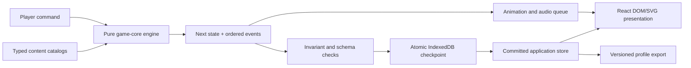
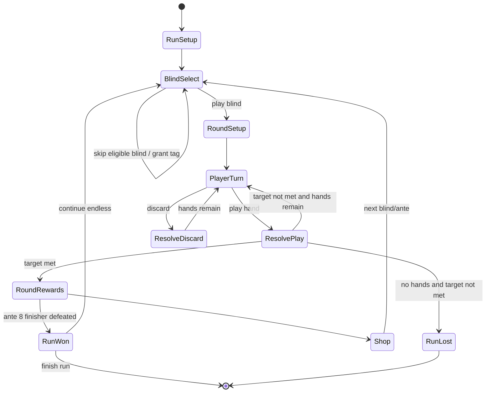

# 百戏奇牌 Technical Design

## 1. Design Objective

Build a complete, local-first Chinese desktop-browser poker roguelike with a
project-owned deterministic engine, data contracts, persistence, presentation,
and assets. Balatro is a frozen gameplay reference only. The application must
not depend on Balatro code, data formats, seeds, saves, names, or presentation.

The architecture must support hundreds of interacting content entries without
allowing UI animation, browser timing, or persistence timing to change gameplay
results.

## 2. Confirmed Boundaries

- Client-only Vite + React + TypeScript application.
- Local execution; no account, API, cloud sync, public deployment, or multiplayer.
- Desktop Chrome, Edge, and Safari; minimum 1280x720; mouse-first input.
- Three isolated local profiles with import/export.
- Atomic autosave after every committed irreversible action.
- Deterministic seeded runs within 百戏奇牌 only.
- Full frozen gameplay catalog with original IDs, names, copy, visuals, and audio.
- Accessibility modes, mobile/touch, gamepad, and platform integrations are out.

## 3. Architecture



Dependency rule: arrows never point from presentation, audio, persistence, or
React back into the game engine.

## 4. Proposed Repository Layout

```text
src/
  app/                 # bootstrap, Redux store, routes/screens, error boundaries
  game-core/
    commands/          # typed player/system commands and validation
    model/             # serializable domain state and branded IDs
    rng/               # stable seeded PRNG and golden vectors
    poker/             # hand classifier and score foundations
    effects/           # effect windows, queue, primitives, handler registry
    rules/             # round, shop, economy, progression, unlock rules
    selectors/         # pure read projections for UI and tests
    invariants/        # state validation and conservation checks
  content/
    catalogs/          # typed definitions by content family
    handlers/          # effect handlers referenced by stable effect IDs
    localization/      # original Simplified Chinese strings
    manifests/         # completeness/test/asset ownership matrices
  persistence/         # IndexedDB adapter, migrations, recovery, import/export
  presentation/
    components/        # cards, slots, ledgers, buttons, tooltips, overlays
    screens/           # profile, menu, table, shop, collection, results, settings
    animation/         # ordered presentation-event consumer
    particles/         # optional non-authoritative Canvas overlay
    audio/             # Web Audio buses, local asset playback, event mapping
    styles/            # tokens, global stage, CSS Modules
  tutorial/            # scripted first-run state and guidance projections
  test-support/        # builders, deterministic fixtures, scenario runner
public/
  assets/              # optimized shipped images/audio
assets-src/            # editable originals and generation manifests
tests/
  e2e/                 # Playwright flows and visual snapshots
```

Files may be refined by the first child task, but the layer direction must remain.

## 5. Domain State

All durable state is plain serializable data. No class instances, functions,
DOM nodes, dates, maps, or audio/animation objects enter domain state.

```text
DatabaseEnvelope
  schemaVersion
  contentVersion
  activeProfileId
  deviceSettings
  profiles[3]

Profile
  id, displayName, createdAtEpochMs
  tutorialState
  progression and deck/stake unlocks
  collection discoveries and stickers
  achievement state
  cumulative statistics
  activeRunId?

RunState
  runVersion, contentVersion, checkpointId
  mode, seed, rngState
  starting deck/stake/challenge configuration
  phase and pending choice
  ante/blind/round state
  draw pile, hand, played cards, discard pile, full deck
  奇牌 and consumable inventories
  shop/pack/tag/voucher state
  money, hands, discards, slots, hand levels
  run statistics and queued deterministic consequences
```

Every entity uses a project-owned stable ID. Display names are never keys.

## 6. Run State Machine



Pack opening, consumable selection, boss reroll, and forced choices are explicit
substates. The engine rejects commands not legal in the current substate.

## 7. Command and Commit Protocol

1. UI dispatches a command with the current `checkpointId`.
2. The orchestrator rejects stale/double commands while one is committing.
3. The pure engine validates legality and computes `nextState` plus ordered
   domain and presentation events.
4. Invariants validate entity uniqueness, card conservation, slot limits,
   non-negative action budgets where required, phase consistency, and RNG state.
5. Persistence writes the next checkpoint and profile summary in one IndexedDB
   transaction while retaining the prior recovery checkpoint.
6. Only after `tx.done` does Redux expose the committed state and enqueue visual
   and audio events.
7. On failure, keep the old committed state and surface a local recovery dialog.

Commands and checkpoints carry monotonic IDs so duplicate clicks, React retries,
or reloads cannot duplicate rewards or purchases.

## 8. Deterministic Randomness

- Implement a documented unsigned-32-bit PRNG contract with stable seed hashing.
- Never use `Math.random()` in domain/content code.
- Random selection consumes explicit RNG state and returns the next state.
- Weighted-pool construction must sort by stable content ID before drawing.
- Persist RNG state at every checkpoint.
- Golden vectors, full scenario replays, and cross-browser fixtures enforce
  determinism.

Seed compatibility is promised only within a declared 百戏奇牌 content version.
Balance/content changes must increment the content version and retain old-run
loading or provide an explicit migration/retirement message.

## 9. Poker Evaluation and Scoring

The evaluator produces all matching hand candidates and a deterministic winning
hand classification. Rules cover base and hidden hands, wild suits, stone cards,
face overrides, shortened straights/flushes, debuffs, and challenge modifiers.

Scoring is an ordered pipeline:

1. classify hand and read its level/base chips/base multiplier;
2. apply pre-score blind and global modifiers;
3. score selected playing cards in deterministic order;
4. resolve repetitions and seal/enhancement/edition behavior;
5. resolve held-in-hand effects;
6. resolve 奇牌 from left to right, including copied/retriggered effects;
7. apply additive then multiplicative changes at their declared windows;
8. finalize score, destruction, money, statistics, and unlock observations;
9. emit a presentation sequence that mirrors, but does not control, the result.

Use JavaScript `number` behind centralized score operations and formatting to
match double-precision behavior through ordinary and endless play. Boundary tests
must cover scientific notation, rounding, very large values, and Infinity.

## 10. Effect System

Content definitions are data, but complex behavior is implemented by typed
project-owned handlers. Do not build an unrestricted scripting language.

Each effect declares:

- effect ID and source content ID;
- legal hook windows;
- priority and source-order rules;
- typed parameters;
- eligibility predicate;
- emitted primitive operations/events;
- copy/retrigger/debuff behavior;
- deterministic tests and interaction categories.

Shared primitives include add chips/multiplier/money, multiply score, create,
copy, transform, enhance, destroy, retrigger, debuff, change slots/budgets,
change shop weights/costs, schedule deferred effects, and record progression.

The queue tracks effect instance/source ancestry, depth, and consumption flags.
Cycle guards must prevent accidental infinite copy/retrigger loops without
silently changing legitimate repeated effects.

## 11. Content and Localization Pipeline

- One typed catalog per content family.
- Zod validates catalogs at development/test startup.
- A manifest tracks stable ID, original Chinese name/copy, art, audio, unlock,
  handler, tests, reference mapping, and completion status.
- Player-facing copy is original Simplified Chinese. Poker facts and effect
  behavior are expressed independently rather than copied from another game.
- Build-time scripts fail on duplicate IDs, missing localization, missing assets,
  orphaned handlers, untested content, or count mismatches.
- Generated or sourced assets require an ownership/license manifest.

## 12. Persistence, Migration, and Import

Use `idb` over IndexedDB with stores for metadata, settings, profiles, runs, and
recovery checkpoints. Each database and export payload has explicit schema and
content versions.

Import flow:

1. parse as untrusted bytes/text;
2. enforce size limit and JSON shape;
3. validate checksum/envelope and schema using Zod;
4. run sequential pure migrations on a copy;
5. validate all invariants and referenced content IDs;
6. preview target profile and require confirmation;
7. write atomically while preserving the current profile as recovery data.

Never execute imported strings, handlers, asset URLs, or HTML.

## 13. Presentation System

Use a single fixed 16:9 stage scaled inside the browser viewport. Critical layout
at 1280x720:

- top hanging placards: 奇牌 and consumable slots;
- left lacquered ledger: ante, blind, target, score, hands, discards, money;
- center stage seal: blind banner, played cards, ordered scoring performance;
- bottom fanned hand: selection, sort, deck view, play/discard actions;
- modal stage layers: shop, packs, collection, profiles, tutorial, achievements,
  settings, run results.

React renders live text and rules. Motion consumes ordered presentation events.
CSS handles simple hover/press feedback. A Canvas overlay may render particles,
but pointer events are disabled and no domain state lives there.

The visual system follows `research/visual-direction.md` and uses custom design
tokens/components rather than a generic UI kit.

## 14. Audio

Use local original assets through Web Audio with separate master, music, and SFX
gains. Audio unlocks on the first user gesture, tolerates autoplay denial, and
never blocks domain resolution. Event-to-sound mapping is presentation data.

## 15. Performance and Browser Compatibility

- Keep the authoritative engine synchronous and bounded per command.
- Target fluid 60 Hz transforms on a modern desktop at 1280x720.
- Avoid layout reads inside animation loops; animate transform/opacity primarily.
- Lazy-load collection illustrations and decode images before critical reveals.
- Keep live DOM card count bounded; virtualize large collection grids if needed.
- Test Chromium and WebKit continuously; smoke real Chrome, Edge, and Safari at
  child and final integration gates.
- No runtime network request is required after local assets load.

## 16. Error Handling and Observability

Player-facing recoverable errors use Chinese dialogs with a clear next action.
Development builds expose structured diagnostic records for command ID, content
version, checkpoint, phase, seed, and source effect IDs without leaking imported
file contents. Persist the last failure summary separately from the valid save.

Error boundaries may recover presentation failures, but domain failures stop the
command and retain the prior checkpoint.

## 17. Task Tree and Dependencies

The parent task is a planning/integration owner and must not be started as an
implementation target.

1. `07-17-playable-foundation-slice` — no dependency.
2. `07-17-complete-run-and-economy` — depends on 1.
3. `07-17-non-joker-content-catalogs` — depends on 2.
4. `07-17-joker-catalog-001-050` — depends on 2 and the approved content matrix.
5. `07-17-joker-catalog-051-100` — depends on 2 and shared primitives stabilized
   by 4.
6. `07-17-joker-catalog-101-150` — depends on 2 and shared primitives stabilized
   by 4-5.
7. `07-17-progression-tutorial-modes` — depends on 3-6.
8. `07-17-midnight-variety-presentation` — depends on functional screens from
   1-7; earlier children still deliver usable baseline UI and assets.
9. `07-17-integration-quality-gate` — depends on every prior child.

## 18. Compatibility and Rollback

- Git commits and task archives form child-level rollback points.
- Database migrations are forward-only code but retain a pre-migration recovery
  record and test downgrade rejection.
- Content changes bump a content version; do not silently run old deterministic
  seeds against new catalogs.
- Asset optimization never removes editable sources or ownership manifests.
- If a child reveals a faulty parent requirement, return to Phase 1, update the
  parent and affected child artifacts, then resume in dependency order.

