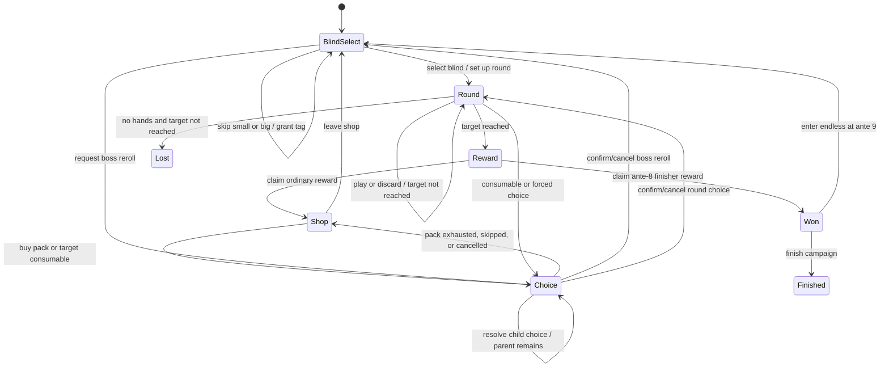

# Complete Run and Economy Technical Design

## 1. Objective and Authority

Extend the archived foundation without weakening its deterministic, pure-core,
atomic-save contracts. The parent PRD/design and
`research/baseline-rules.md` are authoritative. When this child finishes, later
catalog work should add typed definitions and handlers rather than alter the run
state machine, score order, economy, or persistence protocol.

This design deliberately separates engine capability from catalog completeness:
fixture content proves every behavior category, while production catalog counts
remain owned by later tasks.

## 2. Layer and File Direction

The existing dependency direction remains:

```text
content data + handler registry -> pure game-core <- commands
                                      |
                                      v
                           proposed state + events
                                      |
                 invariants -> persistence transaction
                                      |
                                      v
                         Redux committed state -> UI
```

Planned additions refine existing directories:

```text
src/game-core/
  commands/            # complete command union, legality dispatch
  effects/             # windows, queue, operations, registry contracts
  economy/             # price, sale, interest, durable reward receipts
  model/               # V2 run, round, inventory, shop, choice types
  poker/               # candidates, rule context, hand levels
  rules/               # progression, blind, round, scoring, shop, packs
  score/               # number operations, target comparison, formatting
  invariants/          # V2 conservation and phase checks
src/content/fixtures/run-economy/
  catalogs.ts           # namespaced representative definitions
  handlers.ts           # typed handler registry entries
  campaigns.ts          # ordinary/win/loss deterministic configs
src/persistence/
  migrations/           # V1 decoder and pure V1 -> V2 conversion
  transfer/             # tagged non-finite score wire codec
src/presentation/screens/
  BlindSelectScreen.tsx
  RewardScreen.tsx
  PackScreen.tsx
  RunWonScreen.tsx
```

Exact filenames may be split for maintainability, but UI and persistence may not
be imported by `game-core`.

## 3. Durable Run Model V2

`RUN_SCHEMA_VERSION` becomes 2 and the content version becomes
`run-economy-2`. The runtime state remains plain serializable data.

```ts
interface RunStateV2 {
  schemaVersion: 2;
  contentVersion: 'run-economy-2';
  runId: RunId;
  checkpointId: number;
  mode: 'fixture-campaign' | 'migrated-foundation';
  seed: string;
  rngState: RandomState;
  phase: RunPhaseState;
  progress: RunProgress;
  rules: RunRuleState;
  deck: DeckState;
  round: RoundState | null;
  inventory: InventoryState;
  economy: EconomyState;
  shop: ShopState | null;
  pendingChoice: PendingChoice | null;
  history: RunHistory;
  lastHand: ScoreBreakdown | null;
  result: RunResult | null;
}
```

`RunPhaseState` is a discriminated object, not a loose combination of booleans:

```ts
type RunPhaseState =
  | { kind: 'blind-select' }
  | { kind: 'round' }
  | { kind: 'round-reward'; receiptId: RewardReceiptId }
  | { kind: 'shop' }
  | { kind: 'choice'; choiceId: ChoiceId }
  | { kind: 'run-won' }
  | { kind: 'run-lost' }
  | { kind: 'finished' };
```

No synchronous calculation phase is durable. A command either resolves its full
bounded queue and proposes the next player-decision state, or rejects entirely.

`RunProgress` contains:

- current ante and blind position (`small | big | boss`);
- whether the ante-8 campaign win has been recorded;
- whether the run is in endless mode;
- materialized small/big skip tags and current boss definition;
- seen normal/finisher boss IDs and reroll count;
- completed/skipped blind history required by effects.

`DeckState` owns one canonical array of permanent card instances. An active round
stores ordered draw, hand, played, and discard ID sequences; each permanent card
ID occurs in exactly one active zone. Destroyed cards leave both the instance
array and their zone only through an explicit operation, and created cards enter
the instance array and one declared zone exactly once. Outside a round, no zone
copy is required.

Playing-card modifier fields are extended with nullable project-owned
enhancement, seal, and edition IDs plus permanent bonus chips. Current `wild` and
`stone` values migrate to fixture enhancement IDs. Debuff and face-down status
are derived from the active round/blind or stored in round-local ID sets, never
written permanently onto a card by presentation code.

`InventoryState` contains ordered 奇牌 instances, consumables, redeemed voucher
IDs, owned/deferred tags, and computed base/extra slot counts. Negative-edition
style slot exemptions are an instance contribution evaluated by the slot
selector, not a global exception in purchase code.

## 4. State Machine and Commands



New domain commands include:

- `select-blind`, `skip-blind`, `request-boss-reroll`;
- existing select/sort/play/discard commands with V2 legality;
- `claim-round-reward`;
- `buy-shop-offer`, `buy-pack`, `buy-voucher`, `reroll-shop`, `sell-item`,
  `reorder-joker`, `leave-shop`;
- `begin-consumable-choice`, `choose-pack-option`, `toggle-choice-target`,
  `confirm-choice`, `cancel-choice`, `skip-pack`;
- `finish-run`, `enter-endless`.

Every command includes the current checkpoint. Reversible local hover and dialog
state is not a command. Card selection/order remains authoritative because it can
affect forced selection, scoring order, and save/resume; it therefore remains a
checkpointed command as established by the foundation.

`PendingChoice` is a serializable discriminated stack. The current frame may be a
pack option, consumable target selection, boss-reroll confirmation, or forced
card choice; suspended parent frames preserve an interrupted pack or effect flow.
Choice depth is bounded and validated. Target toggles are checkpointed so a
reload restores the exact selection, while cancel is available only when the
frame declares itself optional.

Legality is validated before any random draw or handler runs. Rejections include
stable codes for wrong phase, stale checkpoint, blind not skippable, boss reroll
unavailable, target restriction, pending choice mismatch, offer unavailable,
insufficient funds, inventory full, pool empty, effect cycle/budget, invalid
endless choice, and score overflow terminal.

## 5. Ante, Blind, and Round Routing

### Ante materialization

At run start and after each boss, `materializeAnte`:

1. reads the frozen base target for the ante;
2. resolves the current difficulty/route modifier;
3. deterministically draws and stores tags for small and big;
4. builds the eligible normal or finisher boss pool, sorted by stable ID;
5. excludes seen entries until that pool is exhausted, then resets its cycle;
6. draws and stores the boss and resulting RNG state.

Visible tags and boss never reroll on reload. Boss reroll uses the same pool type,
charges its declared cost atomically, and stores both the replacement and history.

### Blind progression

- Skip is legal only for small/big, grants the visible tag, advances immediately,
  and creates neither reward nor shop.
- Selecting a blind snapshots its target and active rule modifiers into the round,
  shuffles the permanent deck with stored RNG, resets round budgets, and draws the
  initial hand.
- Winning creates a durable reward receipt. Losing creates the terminal result in
  the same play-hand command.
- Leaving an ordinary shop advances small -> big -> boss. Leaving the boss shop
  increments ante and materializes the next ante.
- Claiming ante-8 finisher reward enters `run-won`. `enter-endless` records the
  decision, sets ante 9, and materializes it. Later multiples of eight use
  finisher pools but do not repeat the campaign-win choice.
- At an infinite target, the round remains mathematically unreachable and ends in
  loss when hands exhaust; NaN is never created or persisted.

## 6. Poker Evaluation and Score Arithmetic

`evaluatePokerHands(cards, PokerRuleContext)` returns every matching candidate.
The winning candidate is selected by an explicit strength order, then stable
tie-breaking; the result records both played IDs and scoring IDs.

`PokerRuleContext` supplies:

- minimum straight/flush length and gap rules;
- wild-suit and no-rank predicates;
- face-card override predicate;
- legal play-size/hand-type restrictions;
- hand levels and base-value overrides.

The default 12 hand definitions retain the foundation's frozen chips/mult table.
Hand levels apply definition-owned chips/mult increments without modifying the
catalog object.

All score mutations go through helpers such as `addChips`, `addMult`,
`multiplyMult`, `finalizeScore`, `meetsTarget`, and `formatScore`. Runtime score
values are non-negative JavaScript numbers or positive Infinity; NaN and negative
values fail invariants. Intermediate multiplication preserves normal IEEE-754
behavior and the final hand score uses the declared floor point once.

## 7. Typed Effect Queue

### Hook windows

The initial stable window union is:

```text
blind-selected
round-start
before-hand
scored-card
held-card
joker-independent
after-hand
discard
round-end
blind-skipped
shop-entered
shop-rerolled
item-acquired
pack-opened
ante-ended
```

Scoring sub-order is fixed by the engine, not handler priorities:

1. classify and load base hand values;
2. blind plus `before-hand` sources;
3. each scored playing card left to right;
4. each held card left to right;
5. each independent 奇牌 left to right;
6. eligible consumable/global sources;
7. finalize hand score;
8. `after-hand`, destruction, economy/statistics, draw, and terminal checks.

Within one source/window, emitted operations retain array order. When multiple
effects share a source, numeric priority then stable effect ID breaks ties.

### Registry contract

Catalog data stores `{ handlerId, windows, priority, params }`. The handler
registry maps a handler ID to a typed pure function. A handler receives a readonly
snapshot/context and emits primitive operations; it cannot mutate state, dispatch
commands, access browser APIs, call `Math.random`, or recursively invoke another
handler.

Primitive operations cover:

- add chips, add/multiply multiplier, multiply final score;
- add/spend/set money and append reward lines;
- copy/retrigger another eligible effect source;
- debuff/enable a card, 奇牌, or blind rule for a declared lifetime;
- create, transform, enhance, or destroy an instance;
- adjust action, hand-size, inventory, or temporary pack-choice slots;
- adjust pool weights, prices, discounts, interest, and reroll costs;
- schedule a serializable deferred effect at a later hook;
- record history/stat observations for later progression.

Random primitives ask the queue resolver to select from an already filtered,
stable-ID-sorted pool. Full inventory, empty pool, or failed eligibility emits a
typed no-op outcome and consumes no RNG.

### Copy, retrigger, and cycle safety

Each queue entry carries source instance, effect ID, window, origin command,
ancestry, explicit remaining repetitions, and a unique consumption token.

- Copy creates a queue entry whose execution source position is the copier but
  whose handler/params come from the resolved target.
- Retrigger schedules a bounded repeat of a specific scored/held/source sequence;
  it never calls the handler recursively.
- A repeated signature with no decreasing consumption token is a cycle.
- Maximum ancestry depth is 32 and maximum resolved operations per command is
  10,000. Breach rejects the entire proposal with diagnostics, leaving checkpoint
  and RNG unchanged. Fixture/property tests prove legitimate stacked retriggers
  below these bounds are not truncated.

## 8. Economy and Durable Rewards

Money is an integer and may be negative only when a run rule explicitly provides
a debt floor. Payment legality uses `availableMoney + allowedDebt >= price`.

Winning a round resolves end-of-round handlers, then materializes:

```ts
interface RewardReceipt {
  id: RewardReceiptId;
  blindReward: number;
  remainingHandReward: number;
  interestReward: number;
  effectLines: readonly RewardLine[];
  total: number;
  claimed: boolean;
}
```

The money balance does not change until `claim-round-reward`; that command marks
the receipt claimed, archives it in run history, applies it, and advances exactly
once. Interest is calculated from the post-end-effect, pre-receipt money balance
using the frozen default formula. The receipt is part of saved state, so reload
cannot recompute or reroll it.

Prices are computed by one pure helper from base cost, edition surcharge, discount
and explicit overrides. Half-down rounding is implemented and table-tested rather
than delegated to locale formatting. Sale value derives from current purchase
value unless a definition supplies a typed exception.

## 9. Shop, Voucher, Tag, and Pack Model

`ShopState` stores a unique shop ID, ante/blind origin, materialized card offers,
pack offers, current ante voucher offer, reroll count/cost, and purchased IDs.
Offers contain generated instance metadata, so opening a save never rebuilds them.
Catalog weights are non-negative integer units (decimal reference weights are
scaled once in fixture data), avoiding floating-point sampling differences.

Entering a shop:

1. constructs eligible weighted card pools in stable-ID order;
2. draws the configured number of card offers;
3. materializes two pack offers, including the first-shop guarantee contract;
4. reuses an unpurchased ante voucher or materializes a new one when allowed;
5. applies shop-enter effects and persists the complete result.

Reroll charges and replaces only remaining random card offers. Packs and voucher
remain unchanged. Purchased empty slots stay empty unless an explicit effect
restocks them.

Buying a pack is one checkpoint: charge price, remove the shop offer, generate
options, and push a pack frame into `pendingChoice`. That frame stores the pack
definition/instance, options, allowed and remaining picks, and return phase.
Choosing an option that needs targets pushes a consumable-target frame while the
pack frame is suspended. `toggle-choice-target` persists exact target selection;
`confirm-choice` validates and resolves it, then restores the parent pack with
one fewer pick or returns to shop. `skip-pack` discards the pack frame and all
remaining options. Boss reroll similarly uses a confirmation frame that freezes
cost and eligibility before its random replacement is resolved.

Temporary pack capacity permits choosing an item while the choice itself supplies
an extra slot; otherwise full inventory blocks that option without consuming it.
Generated items are deterministic. Duplicate/no-repeat filters occur before a
random draw, and empty/blocked pools return explicit outcomes rather than loop.

Tags are materialized at ante setup. Immediate tags resolve inside `skip-blind`;
deferred tags store a source and hook and are consumed exactly once when eligible.
Vouchers are run-permanent IDs with prerequisite and no-duplicate checks. Fixture
vouchers cover slot, discount, interest-cap, reroll-cost, and boss-reroll rules.

## 10. Persistence, Transfer, and Migration

### V1 -> V2

A pure migration first validates raw V1 with a frozen V1 schema, then maps:

- `round` to a migrated ante-1 active round preserving target, zones, budgets,
  selected cards, money, inventory, RNG, and last hand;
- `shop` to a migrated post-small-blind shop preserving offers and prices;
- `won`/`lost` to V2 terminal results marked `migrated-foundation`;
- inline V1 shop definitions to namespaced fixture catalog references;
- `wild`/`stone` modifiers to V2 fixture enhancement IDs.

Run/profile IDs and checkpoint IDs are preserved. The migration itself does not
draw randomness.

On first V1 load, the repository opens one read-write transaction, stores the raw
V1 record as recovery, writes the migrated V2 run/profile metadata, awaits
completion, then exposes V2. Failure returns the old profile plus a recovery
message and does not partially update metadata. V1 imports use the same pure
migration and preview path.

### Non-finite score transfer

IndexedDB structured clone may store positive Infinity, but JSON may not encode it
directly. The export checksum is calculated over a canonical wire model that maps
score fields to finite numbers or the string `"Infinity"`. Import decodes the
tag before V2 validation; any `null`, NaN spelling, negative infinity, or misplaced
sentinel is rejected.

All new commands keep the established proposal -> validate -> atomic save ->
Redux expose -> presentation queue order. Presentation events are enqueued only
after `tx.done`.

## 11. Invariants

V2 validation includes:

- schema/content/checkpoint/RNG validity;
- phase, round, shop, receipt, and pending-choice consistency;
- permanent card uniqueness and exact zone conservation;
- selected/forced/face-down IDs belong to legal current zones;
- inventory capacities account for explicit slot-exempt instances;
- money, prices, picks, action budgets, levels, and history counters are integers
  in their declared ranges;
- score values are non-negative finite numbers or positive Infinity, never NaN;
- visible blind/tag/shop/pack IDs resolve to the frozen fixture content version;
- reward/skip/purchase/deferred-source IDs cannot be consumed twice;
- boss history and current pool type agree with ante/finisher routing.

Property tests execute arbitrary legal and rejected command sequences and validate
these invariants after every committed result.

## 12. Fixture Capability Matrix

The child creates only enough namespaced definitions to cover engine behavior:

| Fixture family | Capabilities proven |
|---|---|
| Small/big/ordinary/finisher blinds | routing, target/reward multipliers, skip |
| Debuff/restriction/budget/selection blinds | debuff, rule context, forced state |
| Additive/multiplicative/copy/retrigger 奇牌 | ordered score queue and ancestry |
| Economy/create/destroy/transform fixtures | post-score and inventory mutations |
| Immediate/deferred tags | skip timing and one-shot consequences |
| Slot/discount/interest/boss-reroll vouchers | permanent rule modifiers |
| Playing-card/奇牌/consumable packs | option counts, targets, picks, blocked pools |

Fixture IDs remain under `fixture:run-economy:*` and are excluded from later
production completeness manifests.

## 13. Presentation and E2E Strategy

The existing fixed 16:9 stage gains functional, original Chinese screens while
retaining the foundation visual language. UI derives button legality, receipt
lines, targets, offers, and route labels from selectors.

Campaign E2E uses public application flows and deterministic fixture imports or
fixture campaign configs; it does not inject Redux state or bypass persistence.
A high-scoring fixture build makes a full eight-ante browser route bounded while
unit/scenario tests exercise ordinary scoring difficulty. Chromium and WebKit
reload after representative checkpoints in every phase, including a materialized
pack choice.

## 14. Failure and Rollback

- Domain rejection returns the old state and consumes no RNG.
- Effect cycle/budget failure rejects the whole command and records diagnostics in
  development output only.
- Persistence/migration failure leaves the old committed state visible and offers
  retry/export/recovery actions.
- V1 decoder and migration remain after release; do not delete them during this
  child.
- Fixture content is isolated, so later production catalogs can replace available
  pools without changing V2 structural contracts.
- If implementation proves a parent contract invalid, return this child to
  planning and update both artifacts before continuing.
