# Joker Catalog 001-050 — Technical Design

## 1. Objective

Add the first 50 real production 奇牌 to the existing local V3 game without
turning the catalog into content-ID conditionals. The implementation must compile
the frozen row matrix into runtime definitions, extend deterministic scoring and
lifecycle primitives, persist per-instance ability state, replace the first 50
external capability doubles, and present 50 reviewed original illustrations.

The archived 230-row non-奇牌 catalog remains a frozen subsystem. This task adds a
50-row Joker subsystem and a 280-row production aggregate; it does not redefine
the prior rows.

## 2. Fundamental constraints

- `src/game-core/**` stays framework-free and pure.
- Content contains serializable definitions and registered handler IDs, never
  functions.
- Content IDs identify rows; they never select behavior in score, command, shop,
  migration, or presentation branches.
- The existing 15 effect windows, 32-level ancestry limit, and 10,000-operation
  budget remain hard contracts.
- A command either returns one complete proposed checkpoint or rejects without
  RNG, state, event, or persistence changes.
- Empty/blocked pools and false predicates consume no RNG.
- Saved runs keep their frozen content snapshot. A later catalog batch never
  changes the meaning of an active run.
- Shipped identity, Chinese copy, artwork, prompts, IDs, and code remain original
  to 百戏奇牌.
- All content and images are local; runtime network access is unnecessary.

## 3. Target data flow

```mermaid
flowchart LR
    MATRIX["Frozen 50-row matrix"] --> ROWS["Typed Joker catalog rows"]
    ZH["Name, rules, flavor"] --> ROWS
    ART["50 local images + provenance"] --> ROWS
    ROWS --> VALIDATE["Catalog and manifest validator"]
    VALIDATE --> CATALOG["280-row ProductionCatalog"]
    CATALOG --> COMPILE["Runtime definition compiler"]
    COMPILE --> SNAPSHOT["Frozen run content snapshot"]
    SNAPSHOT --> SHOP["Rarity then row materialization"]
    SHOP --> OWNED["Owned Joker + V4 ability state"]
    OWNED --> TX["Atomic played-hand or lifecycle transaction"]
    TX --> QUEUE["Bounded effect queue"]
    QUEUE --> STATE["Score, RNG, state, creation, destruction"]
    STATE --> CHECK["Schema + invariants"]
    CHECK --> SAVE["Atomic local checkpoint"]
    SAVE --> UI["Committed Chinese presentation"]
```



There is one definition source and one executable proposal path. Audit screens,
shops, tables, tests, and saved snapshots consume projections of that source
instead of maintaining parallel row lists.

## 4. Catalog model

### 4.1 Discriminated row type

Extend the catalog family union with `joker`, but keep Joker-only metadata behind
a discriminated row:

```ts
type ProductionCatalogRow = NonJokerCatalogRow | JokerCatalogRow;

interface JokerCatalogRow extends CatalogRowBase {
  readonly family: "joker";
  readonly rarity: "common" | "uncommon" | "rare" | "legendary";
  readonly flavorKey: string;
  readonly ensemble:
    | "main-stage"
    | "mask-illusion"
    | "backstage-machinery"
    | "music-acrobatics"
    | "midnight-spirits";
  readonly copyPolicy: "output" | "trigger" | "none";
  readonly stickerEligibility: {
    readonly permanent: boolean;
    readonly perishable: boolean;
    readonly rental: true;
  };
  readonly initialAbilityState: Readonly<Record<string, number | boolean | string>>;
}
```

Non-Joker rows do not receive meaningless nullable rarity/state fields. Zod uses a
family discriminated union, and the aggregate type preserves exhaustive switches.

### 4.2 Counts and identity

Export separate generated ledgers:

- `EXPECTED_NON_JOKER_TOTAL = 230` with the existing 13-family counts;
- `EXPECTED_JOKER_BATCH_TOTAL = 50` with 36 Common and 14 Uncommon;
- `EXPECTED_PRODUCTION_TOTAL = 280`;
- `RESERVED_JOKER_IDS = 150`;
- `IMPLEMENTED_JOKER_IDS = 001..050`;
- `UNRESOLVED_JOKER_IDS = 051..150`.

`referenceIndex` is `J001` through `J050` and remains research/audit metadata.
Stable runtime IDs remain `bxqp:joker:001` through `050`.

### 4.3 Localization and assets

Every Joker row resolves three independent strings: name, explicit rules, and
flavor. The runtime definition uses name/rules; flavor is presentation-only and
cannot affect execution.

Extend `AssetOwnershipRecord.source` with `generated-raster` and store:

- local `.webp` path;
- unique focal key;
- prompt/source sidecar path;
- ensemble and dimensions;
- author/ownership declaration;
- inspection status and notes.

The validator rejects missing files, shared Joker focal keys, remote paths,
unreviewed records, or a row without exactly one matching localization/asset/
contract record.

## 5. Dependency resolution

Keep all 150 reserved IDs and owner-task metadata, but compute external status by
subtracting catalog-defined Joker IDs:

```text
reserved 001-150
  - production definitions 001-050
  = unresolved external IDs 051-150
```

Consumers may reference a reserved ID regardless of whether it is local or
external. Validation checks the corresponding real definition first and only
requires an external capability when no local definition exists.

- `catalog-child`: exactly 100 unresolved IDs are allowed after this batch;
  tests may supply declared doubles for those IDs only.
- `integration-strict`: still fails until all 150 definitions exist.
- A double for an already implemented ID is rejected, preventing a real row from
  being silently shadowed.

J038 records an explicit dependency edge to future J061 availability metadata,
but this task does not create a J061 runtime definition.

## 6. Runtime definition compilation

`createProductionRunContent` compiles each `JokerCatalogRow` to a
`JokerDefinitionV2` with:

- resolved Chinese name and rule copy;
- cost, weight, rarity, and slot contribution;
- compiled effect references and passive capability references;
- copy/sticker metadata;
- initial ability-state schema and values.

The definition compiler is exhaustive by row family. It does not infer rarity or
behavior from ordinal, name, or ID. New runs snapshot all 50 compiled definitions;
old runs retain the definitions they already stored.

Acquisition initializes an instance from definition metadata, materializes its
edition/stickers and ability state once, and emits `joker-discovered` observation
only for the first acquisition of that content ID within the available history
boundary.

## 7. Typed Joker behavior primitives

### 7.1 Predicates

Add a serializable predicate union evaluated against a hand/lifecycle context:

```ts
type JokerPredicate =
  | { readonly kind: "always" }
  | { readonly kind: "hand-contains"; readonly fact: HandFact }
  | { readonly kind: "played-card-count-at-most"; readonly count: number }
  | { readonly kind: "scored-card-suit"; readonly suit: Suit }
  | { readonly kind: "scored-card-rank-in"; readonly ranks: readonly Rank[] }
  | { readonly kind: "scored-card-face" }
  | { readonly kind: "held-lowest-rank" }
  | { readonly kind: "all-held-suits"; readonly suits: readonly Suit[] }
  | { readonly kind: "remaining-discards"; readonly comparison: "zero" | "any" }
  | { readonly kind: "final-hand" }
  | { readonly kind: "no-discards-used" }
  | { readonly kind: "run-hand-modulo"; readonly divisor: number; readonly equals: number }
  | { readonly kind: "chance"; readonly numerator: number; readonly denominator: number };
```

Predicates compose only through explicit `all`/`any` nodes with bounded depth.
They cannot contain arbitrary expressions or content IDs.

`HandFactsV3` is computed once from all played cards and contains independent
Pair, Three-of-a-Kind, Two-Pair, Straight, Flush, and displayed-hand facts. It
also contains ordered played/scoring/held card IDs and effective identity
projections.

### 7.2 Dynamic values

Add a small value-expression union for matrix-approved values:

```ts
type JokerValue =
  | { readonly kind: "fixed"; readonly value: number }
  | { readonly kind: "remaining-discards"; readonly scale: number }
  | { readonly kind: "empty-joker-slots-with-stencils" }
  | { readonly kind: "full-deck-modifier-count"; readonly modifierId: string; readonly scale: number; readonly base: number }
  | { readonly kind: "owned-joker-count"; readonly scale: number }
  | { readonly kind: "matching-hand-history"; readonly includeCurrent: boolean }
  | { readonly kind: "selected-held-rank"; readonly scale: number }
  | { readonly kind: "source-state"; readonly key: string }
  | { readonly kind: "uniform-integer"; readonly minimum: number; readonly maximum: number };
```

The value evaluator receives the typed context and source instance. Unknown
state keys, non-finite values, or out-of-range random bounds reject the proposal.

### 7.3 Operations

Reuse existing add-Chips/add-Mult/multiply-Mult, money, rule, creation, hand-level,
and retrigger operations where their semantics already match. Add only shared
irreducible operations:

- guarded/dynamic score contribution;
- scored-card or held-card retrigger with predicate;
- source ability-state set/add/decrement;
- source or immediate-right Joker destruction;
- add random underlying playing card with a fixed enhancement;
- create a typed consumable per scored-card pass;
- source sell-value increment;
- effective passive capability;
- discovery/extinction observation.

Handlers translate serializable parameters into these exhaustive operations.
Applicators switch on operation type, never handler or content ID.

## 8. Atomic V3 played-hand resolver

Introduce a production `resolvePlayedHandV3` wrapper while retaining
`resolveHandScoreV2` unchanged for migrated fixture runs. The V3 resolver owns one
pure proposal:

1. collect active passive capabilities through the bounded queue;
2. derive straight/flush sizes, effective face status, and hand facts;
3. resolve `before-hand` predicates and materialize J045 rolls;
4. apply successful hand-level changes and recompute current base Chips/Mult;
5. apply pre-independent source-state changes for J044 and J049;
6. score cards in order, including modifiers, Joker card effects, immediate
   retriggers, money, capacity, and generated content;
7. resolve held-card passes, including J019 and J029;
8. resolve independent Jokers left-to-right using current state values;
9. compute final score and return the complete state/RNG/materialization delta;
10. let the existing command move zones, append history, and run the ordinary
    `after-hand` window, where J050 decrements/destroys itself.

The result type includes proposed state, score breakdown, played/scoring IDs,
domain/presentation facts, and materialized choices. It does not expose callbacks
or ask presentation to perform a roll.

If any operation fails, the resolver returns a typed failure and discards every
intermediate state/RNG change.

## 9. Passive capability derivation

Passive effects are derived from active, non-debuffed owned sources whenever the
affected rule is queried:

- J018: effective Straight/Flush size floor of four;
- J020: +20 allowed debt per active original instance for new affordability
  checks;
- J030: idempotent one-free-reroll flag per shop entry;
- J037: global effective-face predicate.

J018, J030, and J037 are idempotent across duplicate instances. J020 is additive.
Selling/debuffing/destroying a source changes the next query without rewriting
base run rules.

Existing negative money remains a valid repayment state after J020 disappears;
new purchases require `money - price >= -effectiveAllowedDebt`. Invariants require
finite safe money but no longer equate current negative balance with current
borrowing permission.

## 10. Per-instance state and schema migration

### 10.1 RunStateV4

Introduce schema version 4 because adding required ability state to durable Joker
instances is a structural change. V4 retains the V3 setup/rules/content fields and
adds:

```ts
interface JokerModifierStateV4 extends JokerModifierStateV3 {
  readonly abilityState: Readonly<Record<string, number | boolean | string>>;
}

interface RunStateV4 extends RunStateV2 {
  readonly schemaVersion: 4;
  readonly contentVersion:
    | "run-economy-2"
    | "catalog-baseline-3"
    | "joker-catalog-1";
  // V3 fields, V4 modifier state, and V4 migration metadata
}
```

New production runs use `joker-catalog-1`. Migrated V2/V3 runs keep their embedded
content version and definitions while gaining a valid empty/default ability-state
record for every owned Joker.

### 10.2 State ownership

The first batch uses named state only where required:

- J021 `storedMult = 0`;
- J044 `storedMult = 0`;
- J049 `storedChips = 0`;
- J050 `remainingChips = 100`.

J046 continues to use the existing `sellValueOverride`, initialized from its
ordinary sale value on first increment. J025/J043 use run history and do not copy
derived counters into instance state.

Invariants require exact allowed state keys, primitive finite values, and the
matrix-approved bounds. Synchronization removes modifier records for destroyed or
sold instances and creates definition-derived defaults for newly acquired ones.

### 10.3 Migration and persistence

- Add pure, idempotent V3-to-V4 migration; update V1 -> V2 -> V3 -> V4 loading.
- Preserve checkpoint, RNG, offers, choices, rewards, content definitions, and
  every existing sticker/edition field byte-for-byte except the explicit new
  migration metadata/default state.
- Keep the exact pre-migration run in recovery before atomically committing V4.
- Export V4 envelopes and continue accepting valid V2/V3 envelopes through the
  same migration chain.
- Reject future versions, unknown state keys, non-finite values, or snapshot/
  instance definition mismatches before replacing local data.

## 11. Joker shop and pack selection

Use two deterministic stages for Joker sources:

1. choose among non-empty eligible rarity pools using source weights;
2. choose a row within that rarity by stable ID and row weight.

Ordinary source weights are Common 70, Uncommon 25, Rare 5; Legendary is excluded.
Weights are renormalized over non-empty eligible pools, so this 36/14 batch does
not produce empty Rare offers. Forced rarity sources fail with `pool-empty` and
consume no RNG when that exact pool is empty.

Then materialize edition, sticker, price, and instance identity through the shared
shop/pack path. Eligibility applies, in order:

- source and run-family bans;
- duplicate/current-offer policy;
- availability and J032 full-deck modifier condition;
- sticker/source constraints;
- capacity only at acquisition, not offer generation;
- stable within-rarity weight.

Saved shops and pack choices retain already materialized definitions even if the
profile/catalog later changes.

## 12. Copy, retrigger, debuff, and destruction

- `output` copy evaluates the target's current output at the copy source's queue
  position. It reads target state but never mutates it.
- `trigger` copy performs another stateless activation with its own ordered RNG
  and capacity check.
- `none` operations are filtered before copy traversal.
- Copy ancestry tokens and the existing depth/operation budgets still prevent
  cycles and runaway retriggers.
- A retrigger repeats card scoring effects and card Chips, not the retrigger
  generator itself. Held and scored retriggers are distinct targets.
- Debuffed Joker sources are removed from all ability queues but remain owned
  instances for sale value, slots, stickers, and J034 counts.
- Permanent sticker blocks sale and Joker destruction. Failed destruction produces
  no growth and no RNG rollback problem because target selection is deterministic.
- Self-destruction removes the inventory instance and V4 modifier state together,
  never grants sale money, and emits a committed presentation/domain event.

## 13. Art and presentation

### 13.1 Asset production

Use the project image-generation workflow for each of the 50 approved art briefs.
Generate one text-free portrait master per row, inspect it, then locally optimize
to WebP without changing composition. Retain the full prompt/source sidecar and a
review checklist for:

- unique focal subject, silhouette, and composition;
- ensemble palette/material continuity;
- no reference-game identity or copied character pose;
- no text, logos, watermark, broken anatomy, or unintended modern UI;
- correct crop, dimensions, transparency/edge behavior, and local decode.

Shared lacquer/paper/brass card frames and all rules UI remain project DOM/SVG.

### 13.2 Review ledger

Preserve `?catalog-audit=1` as the exact 230-row non-奇牌 ledger. Add
`?catalog-audit=jokers` for the 50-row Joker review surface with ensemble filters,
rarity/cost, approved rules, flavor, stable ID, and unique art.

### 13.3 Gameplay surfaces

Create shared selectors that resolve Joker presentation and current values from
the committed run snapshot/ability state. Shop, pack, and game-table components
render those selectors and never recalculate effects. Stateful rows show their
current Mult/Chips/count/sell value in Chinese.

The later progression task owns profile collection masking. This task's ledger is
an explicit content-review tool and may show all rows.

## 14. Test architecture

### 14.1 Matrix and schema tests

- exactly 50 contiguous IDs/reference indices and 36/14 rarity split;
- exact name/rules/flavor/art/contract closure;
- exact 230 + 50 = 280 ledgers and 100 unresolved external IDs;
- no duplicate IDs, localization keys, focal keys, state keys, or contract IDs;
- no fixture definitions or remote asset paths.

### 14.2 Behavior tests

Use table-driven row fixtures for fixed score effects and named files for complex
profiles. Each row has positive, false/boundary, and debuffed cases. The frozen
matrix's cross-row list is mandatory, not illustrative.

Property tests cover hand-fact subsets, rank/suit predicates, duplicate passive
sources, capacity, left-to-right ordering, chance frequencies as integer-domain
coverage, and operation budgets.

### 14.3 Persistence and replay

- same seed + same commands yields canonical-equivalent pure checkpoints;
- reload/export/import/recovery around every mutable/RNG row;
- V3-to-V4 migration and idempotence with fixture and production runs;
- rejected operations preserve checkpoint/RNG and prior persisted state;
- destroyed/sold instances leave no orphan V4 state.

### 14.4 Browser evidence

- real campaign acquisition from shop and Buffoon pack;
- stateful current-value updates on the table;
- 50/50 image decode and unique focal keys;
- zero remote requests;
- ensemble ledger screenshots plus representative shop/table screenshots in
  Chromium and WebKit at 1280×720.

## 15. Error and atomicity matrix

| Condition | Required result |
|---|---|
| Predicate/value/state descriptor is invalid | Catalog/schema failure before play |
| Requested forced rarity has no eligible row | `pool-empty`; no RNG or offer mutation |
| J026 has no consumable capacity | No roll, creation, or partial state |
| J021 right target is absent/permanent | No destroy and no stored-Mult change |
| J024 cannot materialize a valid card | Reject blind selection atomically |
| Effect handler missing/cycle/budget exceeded | Reject the full command |
| V4 ability state has an unknown key/value | Invariant failure; do not persist |
| Money is already negative after J020 removal | State remains valid; unaffordable purchases reject |
| Self-destruction would leave orphan modifier state | Invariant failure; do not persist |
| Local art/localization/ownership record is missing | Content audit/build failure |
| Browser image decode or remote request check fails | E2E gate failure |

## 16. High-risk review focus

- `scoreHandV2.ts` and the new V3 resolver: preserve legacy fixture ordering and
  do not double-run `after-hand` effects.
- `executeCommandV2.ts`: integrate one complete V3 proposal rather than adding 50
  branches or committing intermediate state.
- effect registry/applicators: exhaustive operation switches, source-relative
  state, copy facets, and bounded predicates.
- `runV3.ts`/new V4 model and persistence schemas: strict migration, no optional
  escape hatches, no content snapshot replacement.
- shop selection: rarity renormalization, empty-pool RNG behavior, forced rarity,
  and already materialized offers.
- destruction/sale: permanent sticker, slot synchronization, sale override, and
  no-payout removal.
- art manifest: never mark an image reviewed before visual inspection.
