# Joker Catalog 051-100 — Technical Design

## 1. Objective

Add the second 50 production 奇牌 to the accepted V4 game as one deterministic,
data-driven batch. New runs contain 100 real 奇牌 and 330 aggregate catalog rows;
old run snapshots keep their prior content. The engine gains shared event,
mutation, target, economy, and persistence primitives only where the frozen
matrix cannot be expressed by the 001-050 DSL.

No runtime, command, persistence, shop, or React branch may select behavior by
Joker ID, ordinal, Chinese name, ensemble, or illustration.

## 2. Fundamental constraints

- `src/game-core/**` remains framework-free and pure.
- Catalog data is serializable and validated; no row stores a callback.
- One accepted command produces one complete state/RNG/event proposal and one
  checkpoint. A rejection produces no externally visible change.
- The existing copy ancestry limit, effect ordering, and 10,000-operation budget
  remain hard limits across nested card-added/modifier/other-Joker events.
- Predicates and capacity checks precede random consumption. Random outcomes are
  materialized before presentation sees them.
- Fractional persistent Mult uses integer hundredths.
- Passive behavior is derived from currently active owned sources at the use
  site; acquisition and sale do not permanently patch base rules.
- A run's content snapshot is immutable. V5 is a schema migration, not a request
  to inject J051-J100 into an already-started V4 run.
- The 230 non-奇牌 rows and J001-J050 effects remain regression baselines.
- All presentation assets are local. The browser performs no runtime fetches.

## 3. Target data flow

```mermaid
flowchart LR
    MATRIX["Frozen J051-J100 matrix"] --> ROWS["Typed Joker rows"]
    COPY["Original zh-CN rules + flavor"] --> ROWS
    ART["50 WebP + provenance"] --> ROWS
    ROWS --> VALIDATE["Catalog / contract / asset validation"]
    VALIDATE --> CATALOG["330-row production catalog"]
    CATALOG --> COMPILE["Serializable run definitions"]
    COMPILE --> SNAPSHOT["V5 frozen content snapshot"]
    SNAPSHOT --> COMMAND["Command admission"]
    COMMAND --> FACTS["Immutable JokerEventFactsV5"]
    FACTS --> QUEUE["Bounded ordered effect queue"]
    QUEUE --> PROPOSAL["Score + cards + inventory + RNG + history proposal"]
    PROPOSAL --> INVARIANT["V5 schema and invariants"]
    INVARIANT --> CHECKPOINT["Atomic local checkpoint"]
    CHECKPOINT --> VIEW["Definition/current-value projections"]
```



Definitions, saved snapshots, gameplay, audit screens, shops, packs, and table
cards remain projections of one source. React neither rolls nor evaluates rules.

## 4. Catalog evolution

### 4.1 Version and counts

Keep the existing `CATALOG_CONTENT_VERSION = 'catalog-baseline-3'` as historical
row-introduction metadata. Add an aggregate production version
`PRODUCTION_CATALOG_VERSION = 'joker-catalog-2'` and widen `introducedIn` to the
known version union. Existing rows retain their current value; J051-J100 declare
`joker-catalog-2` explicitly.

Freeze generated ledgers:

```ts
EXPECTED_NON_JOKER_CATALOG_TOTAL = 230;
EXPECTED_JOKER_CATALOG_TOTAL = 100;
EXPECTED_PRODUCTION_CATALOG_TOTAL = 330;
IMPLEMENTED_JOKER_IDS = 001..100;
UNRESOLVED_JOKER_IDS = 101..150;
```

The validator separately proves 19/25/6 rarity counts for this batch and the
combined 100-row rarity count. It rejects gaps, duplicates, fixture definitions,
and an external double for any implemented ID.

### 4.2 Ensembles and availability

Extend `JokerEnsemble` with five presentation-only values:

```ts
'creation-secret' | 'disordered-machine' | 'cloud-traveler'
| 'night-market-ledger' | 'strange-beast-finale'
```

Their localized audit labels are 造化秘戏, 失序机关, 云路贵客, 夜市账房, and
异兽散场. No gameplay predicate accepts an ensemble.

Existing generic availability expresses the three exceptions:

- J061: prerequisite observation `joker-038-extinct`;
- J089: full deck contains `bxqp:enhancement:stone-mask`;
- J091: full deck contains `bxqp:enhancement:lucky-knot`.

The prerequisite evaluator reads durable observations; discovery remains
first-acquisition metadata and never enters eligibility.

### 4.3 Row compilation

Append 50 `JokerSource` records to the existing builder. Add no parallel runtime
registry. Each row compiles to the current `JokerDefinitionV2` shape plus its
effect references and initial state. The compiler must exhaustively serialize
every new predicate/value/operation to primitive parameters.

Row validation checks that:

- row-level copy policy agrees with every operation facet;
- initial ability-state keys and types match all state reads/writes;
- hundredths values are safe integers and legal factors;
- self-destroy/sale rows exclude Permanent exactly as frozen;
- scaling rows exclude Perishable exactly as frozen;
- every row owns localization, three base contract IDs, art, and provenance.

## 5. V5 durable model

### 5.1 Schema

Create `runV5.ts` rather than extending the already mixed V3/V4 module again:

```ts
export const RUN_SCHEMA_VERSION_V5 = 5 as const;
export const CONTENT_VERSION_V5 = 'joker-catalog-2' as const;

interface JokerRuntimeStateV5 {
  readonly initialDeckSize: number;
  readonly sharedRoundTargetRank: JokerRank | null;
  readonly sharedRoundTargetSuit: JokerSuit | null;
  readonly bossDisabledForRound: boolean;
}

interface MigrationMetadataV5 {
  readonly sourceSchemaVersion: 1 | 2 | 3 | 4 | 5;
  readonly sourceContentVersion: string;
  readonly sourceCheckpointId: number;
  readonly recoveryFingerprint: string;
}

type RunStateV5 = Omit<RunStateV4, 'schemaVersion' | 'contentVersion'> & {
  readonly schemaVersion: 5;
  readonly contentVersion:
    | 'run-economy-2'
    | 'catalog-baseline-3'
    | 'joker-catalog-1'
    | 'joker-catalog-2';
  readonly jokerRuntimeV5: JokerRuntimeStateV5;
  readonly migrationV5: MigrationMetadataV5;
};
```

`initialDeckSize` is captured after setup has materialized the full starting
deck and before any gameplay event. Shared targets are `null` until the first
relevant source is acquired, then materialized once and persisted. Target
changes consume the ordinary run RNG only when at least one relevant active
source exists.

J060's independent `targetHand` stays in instance ability state. Factor state is
stored as integer keys such as `multFactorHundredths`; current-value projections
divide by 100 only at evaluation/render time.

### 5.2 Migration and compatibility

Add a pure V4-to-V5 migration:

- preserve the V4 content version and frozen 50-row snapshot;
- set `initialDeckSize` to the current durable deck length, the only fact a V4
  checkpoint can prove after historical mutation;
- initialize shared targets to `null` and Boss suppression to false;
- do not consume RNG or invent J051-J100 definitions;
- record migration metadata/fingerprint and validate the result.

V1→V2→V3→V4→V5 remains the single forward chain. Import/export, IndexedDB
recovery, metadata repair, and last-known-good fallback write V5 envelopes after
normalization while continuing to accept V2-V4 inputs. `isCatalogRunState`
includes V5; V4-specific state access becomes an `isAbilityStateRun` guard for
V4/V5 so existing services do not accidentally reject new runs.

## 6. Typed event context

### 6.1 Window union

Align catalog triggers and runtime windows by adding:

```ts
type NewEffectWindow =
  | 'consumable-used'
  | 'pack-skipped'
  | 'item-sold'
  | 'playing-card-added'
  | 'playing-card-modifier-succeeded'
  | 'other-joker-resolved';
```

These are domain events inside the proposal, not UI callbacks. Existing windows
retain their meanings. Nested windows consume the same ancestry/operation
budget, and recursive event emission is rejected when it exceeds the registry
contract.

### 6.2 Event facts

Extend the DSL context with a discriminated value:

```ts
type JokerEventFactsV5 =
  | { kind: 'none' }
  | {
      kind: 'played-hand';
      playedCardIds: readonly CardId[];
      firstHandOfRound: boolean;
      displayedHand: PokerHandType;
      previousRoundHandTypes: readonly PokerHandType[];
    }
  | {
      kind: 'discard';
      discardedCardIds: readonly CardId[];
      firstDiscardOfRound: boolean;
      forced: boolean;
    }
  | { kind: 'consumable-use'; family: ConsumableFamily; contentId: string }
  | { kind: 'pack'; packId: string; action: 'opened' | 'skipped' }
  | { kind: 'item-sale'; family: 'joker' | 'consumable'; instanceId: string }
  | { kind: 'playing-card-added'; cardIds: readonly CardId[]; reason: string }
  | {
      kind: 'modifier-success';
      cardId: CardId;
      modifierId: string;
      successfulBranches: number;
      passIndex: number;
    }
  | {
      kind: 'other-joker';
      instanceId: JokerInstanceId;
      rarity: JokerRarity;
      debuffed: boolean;
      position: number;
    }
  | { kind: 'blind-result'; position: BlindPosition; defeated: boolean };
```

The context also exposes stable effective identities for event card IDs. An
operation cannot reach back into mutable UI selection. Event facts are ephemeral;
only defined observations/materialized choices and resulting state persist.

### 6.3 Command proposal helper

Introduce a small framework-free transaction helper used by command paths:

```ts
interface RunProposalV5 {
  readonly state: RunStateV5;
  readonly domainEvents: readonly DomainEventV2[];
  readonly presentationEvents: readonly PresentationEventV2[];
}

emitJokerWindowV5(proposal, window, facts, options): Result<RunProposalV5>;
```

It freezes the source/copy graph for that window, resolves operations, applies
them to a local proposal, validates bounds, and returns either the whole next
proposal or one failure. Commands checkpoint only after their complete event
chain and V5 invariants pass.

## 7. DSL extensions

### 7.1 Predicates

Add only matrix-required discriminants:

```ts
type JokerPredicateV5 = JokerPredicate |
  { kind: 'played-card-count-exactly'; count: number } |
  { kind: 'first-hand-of-round' } |
  { kind: 'first-discard-of-round' } |
  { kind: 'displayed-hand'; source: 'fixed' | 'source-target'; hand?: PokerHandType } |
  { kind: 'played-effective-rank-in'; ranks: readonly JokerRank[] } |
  { kind: 'hand-played-earlier-this-round' } |
  { kind: 'event-family'; family: string } |
  { kind: 'event-card-count-at-least'; selector: 'face' | 'target-rank'; count: number } |
  { kind: 'money-at-most'; amount: number } |
  { kind: 'blind-position-in'; positions: readonly BlindPosition[] } |
  { kind: 'scored-card-target-suit' } |
  { kind: 'scored-card-enhanced' } |
  { kind: 'other-joker-rarity'; rarity: JokerRarity };
```

Exact-one conditions compose exact count with first hand/discard. Event-card
selectors ignore debuffed/Stone identities according to the matrix. Boolean
composition keeps the existing bounded depth and short-circuit/no-extra-RNG rule.

### 7.2 Values

```ts
type JokerValueV5 = JokerValue |
  { kind: 'draw-pile-count'; scale: number } |
  { kind: 'event-card-count'; selector: 'all' | 'face' | 'target-rank'; scale: number } |
  { kind: 'full-deck-rank-count'; rank: JokerRank; identity: 'printed' | 'effective'; scale: number } |
  { kind: 'initial-deck-size-delta'; scale: number; floor: number } |
  { kind: 'history-event-count'; event: 'tarot-used'; scale: number } |
  { kind: 'money'; scale: number; floor: number } |
  { kind: 'source-state-ratio'; key: string; divisor: number };
```

Target hand/rank/suit themselves are string state read by predicates and current-
value presentation, not coerced into numeric values.

### 7.3 Operations

Extend `CatalogOperation` with shared intent-level operations:

- `joker-clone-played-card`: snapshot timing, destination hand, copy facet;
- `joker-add-card-bonus`: amount, predicate, trigger copy facet;
- `joker-transform-enhancement`: set/remove, target scoring card, copy facet;
- `joker-destroy-event-card`: selected/exact-one target and timing;
- `joker-random-destroy-other`: target filters and independent growth operation;
- `joker-state-change-clamped`: integer delta/set, min/max, optional destroy
  threshold, and noncopying state semantics;
- `joker-set-target`: per-instance/shared, hand/rank/suit pool, weighted policy,
  non-repeat policy, and materialization kind;
- `joker-inventory-sell-value-add`: Joker/consumable/both, amount;
- `joker-create-fixed-tag`: tag content ID and sale trigger facet;
- `joker-disable-current-boss`;
- `joker-passive-capability`: all-played-score, Straight max step, hand-size
  delta, discard-per-round delta, or extra-interest component;
- `joker-after-rarity`: exact target rarity and multiplier;
- `joker-record-observation`: typed family/use/add/success evidence where durable
  history is required.

Applicators switch on operation type only. Parameters may include modifier/family
IDs because those are data targets; they may not include a Joker ID to select a
code path.

### 7.4 Copy facets

Separate state mutation from copied output in compiled effects. For example,
J065 emits one noncopying `state-change-clamped` followed by one copyable score
operation. J056's card mutation is a trigger-copy action. J077/J094 are
trigger-copy sale actions; the copy graph is frozen before the sold instance is
removed. The validator rejects an operation facet inconsistent with the row's
frozen `output` / `trigger` / `none` policy.

## 8. Passive capabilities and hand facts

Evolve the collector to `JokerPassiveCapabilitiesV5`:

```ts
interface JokerPassiveCapabilitiesV5 extends JokerPassiveCapabilitiesV3 {
  readonly allPlayedCardsScore: boolean;
  readonly straightMaximumStep: 1 | 2;
  readonly handSizeDelta: number;
  readonly discardsPerRoundDelta: number;
  readonly extraInterestSources: readonly { sourceInstanceId: string; rate: number }[];
}
```

- Boolean and maximum-step capabilities are idempotent; duplicate J052/J069 does
  not stack.
- Hand-size/discard deltas sum active sources with safe bounds.
- Source-specific interest entries preserve reward trace and separate caps.
- J080 reads its current integer state; J087/J088 use fixed deltas.

`buildHandFactsV5` evaluates the ordinary displayed hand first. It then selects
scoring IDs from ordinary candidates or every played ID when the capability is
active. Poker candidate detection receives `straightMaximumStep`; no Joker
content is visible to the evaluator.

Hand size is recalculated before each draw. If a source disappears while the
hand already exceeds the new limit, current cards stay; the next draw only fills
up to the recomputed limit. Discards per round are frozen after the blind-selected
queue and round-start passive collection, so later sale/debuff affects the next
round rather than rewriting spent resources.

## 9. Played-hand transaction

Replace the V4-only routing check with a production V5 resolver while retaining
V2/V3/V4 compatibility resolvers for frozen old runs.

### 9.1 Admission and facts

1. Validate current phase, selection, and blind restrictions.
2. Collect passives and build V5 hand facts.
3. Freeze `played-hand` event facts and the J051 command-entry clone snapshot.
4. Resolve first-hand/before-card actions. J051 records a deferred clone; J054
   records deferred original destruction; J068/J076 mutate enhancements in source
   order while facts remain frozen.

### 9.2 Card passes

For each scoring card and retrigger pass:

1. read the current committed-in-proposal card state;
2. add printed/permanent Chips and active enhancement/edition output;
3. when a 吉结 branch succeeds, emit one `modifier-success` event containing
   branch count; J091 grows at most once for that pass;
4. resolve scored-card Joker output in source order, including J078/J099;
5. apply J056 bonus growth after the pass;
6. enqueue immediate retrigger passes without recursively retriggering the
   retrigger source.

Held-card passes then resolve J072/J082 with the existing held retrigger rules.

### 9.3 Joker passes

Before independent output, apply J058/J065/J075/J098 state changes so the current
hand uses the new/reset value. Iterate owned Jokers left-to-right. After each
position, emit `other-joker-resolved` with its frozen definition rarity even if
that target was debuffed or had no score operation. Every active J092 source
resolves immediately after the target position. The event is not emitted after
J092's own inserted output, preventing recursion.

### 9.4 Commit

Materialize deferred J051 clones, then J054 destruction, playing-card-added
events, zone movement, replacement draw, history, and score. Run after-hand
effects, V5 invariants, and one checkpoint. Any failure rolls the whole proposal
back, including score, card mutations, generated items, money, RNG, and history.

## 10. Lifecycle transactions

### 10.1 Discard

Capture discarded cards/effective identities and `firstDiscardOfRound` before
zone movement. Resolve card modifier discard effects first, then the generic
Joker discard window against the immutable snapshot. J095 destruction is a
proposed deck/zone removal; J057/J083/J058/J100 still see the original set.
Replacement draw occurs after the effect chain so destroyed cards cannot return.

### 10.2 Consumable use and card addition

After a consumable effect succeeds, emit `consumable-used` with its catalog
family and content ID. J055 state growth and the durable Tarot-use observation
occur in the same proposal. Failed targeting/use emits neither.

All permanent additions route through one `addPlayingCardsV5` helper. It updates
deck/round zones and modifier mirrors, emits one `playing-card-added` event with
all new IDs, and lets each active J070 grow once per ID. Transform/copy-overwrite,
reload, and mirror synchronization do not emit the event.

### 10.3 Packs and rerolls

`buyPack` emits `pack-opened` only after options materialize. `skipPack` emits one
`pack-skipped` before closing the frame. Finishing all picks is not a skip. J085
checks capacity before chance; J063 state growth uses the skip event. The existing
post-success `shop-rerolled` window drives J096 for both paid and free rerolls.

### 10.4 Blind selection and result

Blind selection resolves current sources left-to-right. J064 growth and random
destruction are separate operations; J067 creation mutates the target pool only
for later sources. Round-start resources/passives are computed after the queue.

At a defeated round, pass blind position into the round-end proposal. J074 adds 2
to its payout state before producing the same receipt's line when the position is
Boss. Reset `bossDisabledForRound` when the next blind starts.

### 10.5 Sale

Validate sale and freeze the owned layout/copy graph before removal. Emit
`item-sold` against that snapshot, letting active source/copier effects propose
Boss suppression or a fixed tag. Then remove the item, pay its pre-removal sale
value, recompute passives, validate, and checkpoint. Non-sale destruction never
uses this window.

Boss suppression is a V5 round flag consulted by target/restriction/debuff
resolution. Setting it immediately recomputes the current Boss target against the
ordinary Boss multiplier and stops later Boss rule checks; already committed hand
results are not rewound.

### 10.6 Round end and interest

Use one explicit ordered service:

1. resolve ordinary `round-end` sources left-to-right;
2. apply J080/J097 decrement/destruction and other source state changes;
3. apply J074 Boss growth and all active end-round money lines;
4. settle perishable/rental stickers;
5. calculate base interest from post-effect money;
6. calculate one separately capped J084 component per active source;
7. rotate active J060/J099 targets and prepare shared J083 target for the next
   round at the documented boundary;
8. validate and build the reward receipt.

Gift Card updates every current Joker/consumable sale override, including itself.
Destroyed items are absent. Target debuff is irrelevant; source debuff skips the
operation.

## 11. Random target services

Create reusable target materializers, each returning state, selected value, and
evidence:

- `independent-hand-target`: uniform eligible hand list per J060 instance;
- `weighted-full-deck-rank`: uniform card index among non-Stone cards, then its
  rank; Ace fallback with no RNG when the pool is empty;
- `shared-nonrepeating-suit`: uniform among the three suits excluding current;
- `random-other-joker`: uniform eligible instance after source/Permanent filters.

Pool order is stable (canonical hand/rank/suit order or current Joker position).
No target is selected in React. Shared targets initialize on first relevant
acquisition and persist across source absence; later active round transitions
update them as frozen in the matrix.

## 12. Presentation and local assets

Extend generic `jokerPresentation` projections with typed current values:

- stored Chips/Mult and factor hundredths;
- draw-pile/full-deck counts and initial-size delta;
- target hand/rank/suit;
- payout/hand-size bonus;
- Tarot-use count, money-derived Chips, and modifier counts.

The projection evaluates the same `JokerValue`/state metadata used by gameplay or
reads a compiled presentation descriptor. It never switches on content ID.
Unowned audit cards show frozen initial/example values; owned cards show committed
state only.

Append 50 local 768×1024 WebP files and provenance sidecars. Extend the manifest
validator to expect 100 unique Joker focal keys/assets. The audit route paginates
the 100-row ledger by the ten approved ensembles and retains the non-奇牌 view.
Representative shop, pack, and table screenshots remain 1280×720 Chromium and
WebKit. Accessibility-specific changes remain out of scope.

## 13. Validation strategy

### 13.1 Definition and schema tests

- exact IDs/counts/rarities/costs/availability/copy/sticker/ensemble ledgers;
- 330 aggregate rows, 100 local Joker definitions, 50 unresolved IDs;
- exhaustive DSL serialization/parsing and invalid state/target rejection;
- V4→V5, V2→V5 chain, idempotent normalization, import/export, IndexedDB repair,
  recovery fingerprint, and old frozen snapshot behavior.

### 13.2 Engine tests

- one positive, boundary, and debuffed fixture per row;
- every named interaction in the frozen matrix;
- property tests for fixed-point thresholds, deck-size delta, rank weighting,
  non-repeating suits, interest caps, left-to-right destruction, and queue bounds;
- same seed/commands before and after reload; false/rejected branches preserve RNG;
- complete J001-J050 suite after every shared primitive slice.

### 13.3 Integration and presentation tests

- real shop, Buffoon-equivalent pack, blind selection, score, discard,
  consumable-use, pack open/skip, reroll, sale, reward, save/load paths;
- discovery and J038→J061 persisted availability;
- 100-row audit pagination, localization/current-value copy, image decoding,
  provenance, unique focal keys, and no remote URLs;
- Chromium/WebKit campaign smoke and visual review at 1280×720.

## 14. Rollout and rollback

Implement in independently green slices. Shared primitives land before rows that
consume them; each slice runs the old 001-050 regression subset. Do not partially
ship a V5 writer without its parser/migration/recovery/import paths.

Rollback points:

1. catalog/version/count scaffolding;
2. V5 model and migrations;
3. event context/window coordinator;
4. score/card mutation primitives;
5. lifecycle/sale/round services;
6. row groups 051-070, 071-085, 086-100;
7. presentation/assets and full integration.

Because no deployment or cloud data is in scope, rollback is a source revert to
the previous green slice. Existing V4 saves remain recoverable throughout. Once a
V5 checkpoint is written, rollback testing must use the V5 reader retained on the
branch; never delete local saves as a development shortcut.

## 15. Expected affected surfaces

- `src/content/schema/catalog.ts`
- `src/content/schema/validateCatalog.ts`
- `src/content/catalogs/jokers.ts`
- `src/content/runtime/productionRunContent.ts`
- `src/content/runtime/runSetupV5.ts`
- `src/content/dependencies/externalDependencies.ts`
- `src/content/localization/zh-CN.ts`
- `src/content/manifests/assets.ts`
- `src/game-core/model/runV2.ts`
- `src/game-core/model/runV5.ts`
- `src/game-core/rules/jokerEffectDslV5.ts`
- `src/game-core/rules/jokerPassiveCapabilitiesV5.ts`
- `src/game-core/poker/handFactsV5.ts`
- `src/game-core/poker/evaluate.ts`
- `src/game-core/effects/registry.ts`
- `src/game-core/effects/scoreHandV5.ts`
- `src/game-core/effects/runWindowV5.ts`
- `src/game-core/effects/applyStateOperationV5.ts`
- `src/game-core/commands/executeCommandV2.ts`
- `src/persistence/schemasV5.ts`
- `src/persistence/migrations/migrateRunV4ToV5.ts`
- `src/persistence/indexedDbRepository.ts`
- `src/persistence/profileTransfer.ts`
- `src/presentation/selectors/jokerPresentation.ts`
- `src/presentation/catalog/CatalogAuditScreen.tsx`
- `public/assets/jokers/051.webp` through `100.webp`
- `public/assets/jokers/provenance/051.json` through `100.json`
- corresponding unit, property, component, persistence, E2E, and visual tests
