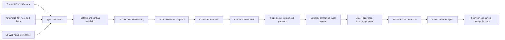

# Joker Catalog 101-150 — Technical Design

## 1. Objective

Add the final 50 production 奇牌 to the accepted V5 game as one deterministic,
data-driven batch. New runs contain 150 real 奇牌 and 380 aggregate definitions;
old run snapshots retain their original frozen content. The engine gains shared
copy-graph, chance, suit, destruction, Boss, sale-clone, shop-exit, inventory,
and V6 persistence primitives only where the frozen matrix cannot be expressed
by the J001-J100 contracts.

No runtime, command, persistence, shop, selector, or React branch may choose
behavior by Joker ID, ordinal, Chinese name, ensemble, or asset path.

## 2. Fundamental constraints

- `src/game-core/**` remains framework-free and pure.
- Catalog data remains serializable and exhaustively validated; no row stores a
  callback, component, or mutable singleton.
- One accepted command produces one complete state/RNG/domain/presentation
  proposal and one checkpoint. Any late failure returns the original state.
- Event facts, source layout, compatible facets, and relevant target pools are
  frozen at the named event boundary.
- Predicates/capacity checks precede random consumption. Every consumed roll or
  choice is durable; deterministic false/certain/empty branches consume none.
- Dynamic copy cycles are legal layout outcomes and suppress only the cyclic
  branch. Invalid static contracts and the 10,000-operation budget still fail
  the proposal.
- Persistent fractional Mult uses integer hundredths. Chance arithmetic uses
  safe saturating integers.
- Passive behavior is derived from currently active owned sources at each use
  site. Acquisition/sale/debuff/destruction never permanently patches base
  rules.
- A run's content snapshot is immutable. V6 migration never injects J101-J150
  into an old V5 `joker-catalog-2` run.
- All 230 non-奇牌 definitions and J001-J100 mechanics remain regression
  baselines.
- All presentation assets are local; the browser performs no runtime fetch.

## 3. Target data flow



Definitions, frozen saves, gameplay, audit screens, shops, packs, and table
cards remain projections of the same source. React neither rolls nor evaluates
rules.

## 4. Catalog evolution

### 4.1 Version, counts, and dependency closure

Advance the production version without rewriting historical introduction data:

```ts
export const PRODUCTION_CATALOG_VERSION = 'joker-catalog-3' as const;

EXPECTED_NON_JOKER_CATALOG_TOTAL = 230;
EXPECTED_JOKER_CATALOG_TOTAL = 150;
EXPECTED_CATALOG_TOTAL = 380;
IMPLEMENTED_JOKER_IDS = 001..150;
UNRESOLVED_JOKER_IDS = [];
```

J001-J050 retain their original introduction version, J051-J100 retain
`joker-catalog-2`, and J101-J150 declare `joker-catalog-3`. The aggregate
validator proves contiguous IDs, the 6/25/14/5 batch rarity split, zero Joker
external doubles, and no fixture row in production.

Remove the reserved legendary dependency from the existing `legend-call`
Spectral-equivalent row. Its typed creation operation selects only Legendary
Jokers from the frozen catalog. Ordinary rarity selection continues to exclude
Legendary; explicit challenge/starting-inventory lookup remains allowed.

### 4.2 Ensembles and availability

Extend `JokerEnsemble` with presentation-only values:

```ts
type FinalBatchEnsemble =
  | 'brass-dispatch'       // 铜线急报
  | 'four-color-procession'// 四色巡游
  | 'mirror-stage'         // 镜局重台
  | 'grand-formation'      // 百相压轴
  | 'starfire-legend';     // 星火终章
```

No predicate or operation accepts an ensemble.

Existing `deck-contains-modifier` expresses J106/J120. All other
non-Legendary rows are baseline eligible for this child. Add a validated
Legendary acquisition-source contract rather than a profile achievement gate;
the later progression child may map achievements without changing mechanics.
Discovery remains first acquisition.

### 4.3 Row and definition shape

Append 50 `JokerSource` records to the existing builder. Add two generic
metadata fields required by dynamic copy routing:

```ts
type JokerCopyPolicy = 'output' | 'trigger' | 'route' | 'none';
type JokerCopyTarget = 'none' | 'right' | 'leftmost';

interface JokerCatalogRow {
  // existing fields...
  readonly copyPolicy: JokerCopyPolicy;
  readonly copyTarget: JokerCopyTarget;
}
```

The compiler carries `copyTarget` into `JokerDefinitionV2`, `MaterializedItem`,
and `OwnedJokerV2`. Existing rows default to `none`; J123 uses `right`, J138 uses
`leftmost`. A router is itself compatible, so another router can traverse it.

Validation additionally proves:

- row copy policy and every operation `copyFacet` agree with the matrix;
- only a `route` row has a non-`none` target;
- initial ability-state keys/types close over all reads/writes;
- hundredths/counters are safe integers with legal minimums;
- sticker exclusions match the six frozen exclusions;
- every row owns localization, three base contracts, art, provenance, ensemble,
  and at least one named interaction fixture.

## 5. V6 durable model

### 5.1 Schema

Create `src/game-core/model/runV6.ts`:

```ts
export const RUN_SCHEMA_VERSION_V6 = 6 as const;
export const CONTENT_VERSION_V6 = 'joker-catalog-3' as const;

interface JokerRuntimeStateV6 {
  readonly castleTargetSuit: JokerSuit | null;
  readonly idolTargetRank: JokerRank | null;
  readonly idolTargetSuit: JokerSuit | null;
  readonly jokerCapacityDebt: number;
}

interface MigrationMetadataV6 {
  readonly sourceSchemaVersion: 1 | 2 | 3 | 4 | 5 | 6;
  readonly sourceContentVersion: string;
  readonly sourceCheckpointId: number;
  readonly recoveryFingerprint: string;
}

type RunStateV6 = Omit<RunStateV5, 'schemaVersion' | 'contentVersion'> & {
  readonly schemaVersion: 6;
  readonly contentVersion:
    | 'run-economy-2'
    | 'catalog-baseline-3'
    | 'joker-catalog-1'
    | 'joker-catalog-2'
    | 'joker-catalog-3';
  readonly jokerRuntimeV6: JokerRuntimeStateV6;
  readonly migrationV6: MigrationMetadataV6;
};
```

Keep `jokerRuntimeV5` inside the inherited V5-compatible fields: its initial
deck size, J083 rank, J099 suit, and one-shot Boss disable retain their existing
meanings. J103/J127 use only V6 targets.

Per-instance state stays in the accepted ability map:

| Rows | Initial ability state |
|---|---|
| J102 | `remainingHands: 10` |
| J103 | `storedChips: 0` |
| J105 | `multFactorHundredths: 100` |
| J120 | `multFactorHundredths: 100` |
| J124 | `storedChips: 0` |
| J130 | `roundMultFactorHundredths: 100` |
| J137 | `roundsReady: 0` |
| J146 | `multFactorHundredths: 100` |
| J148 | `multFactorHundredths: 100`, `discardRemainder: 0` |

Derived probability, duplicate, price, suit, resource, and Boss capabilities
are not persisted.

`jokerCapacityDebt` must equal `max(0, usedJokerSlots - jokerSlots)` after a
committed operation. Only the generic validated Joker-clone operation may raise
it; every removal/capacity increase normalizes it. Ordinary acquisition requires
debt zero and sufficient free slots.

### 5.2 Target lifecycle

J103 and J127 targets are run-shared, not per instance:

- the first relevant acquisition materializes a null target immediately;
- when the last owned relevant source disappears, clear that target;
- after round settlement, prepare the upcoming target when an active source
  exists; otherwise clear it;
- at blind selection, materialize a still-null target if a source has become
  active after transient debuff reset;
- choose one non-Stone full-deck card in stable card-ID order with a uniform
  index draw. J103 reads base suit; J127 reads rank/base suit;
- all-Stone fallback is Spades for J103 and Ace of Spades for J127, without RNG.

Each materialization appends one choice record with target, pool IDs, selected
index, event identity, and checkpoint. Multiple instances share the target but
own independent score/growth output.

### 5.3 Migration and compatibility

Implement pure V5→V6 migration:

- preserve content version and the complete frozen V5 content snapshot;
- initialize all three V6 targets to null without RNG;
- set capacity debt to the provable `max(0, usedSlots - slots)` so a valid
  challenge overage is preserved rather than erased;
- record metadata/fingerprint and validate the result;
- never compile or inject J101-J150 into the migrated run.

V1→V2→V3→V4→V5→V6 remains the only forward chain. IndexedDB normalization,
profile transfer, recovery, metadata repair, last-known-good fallback, and wire
encoding write V6 after normalization while accepting V2-V5 inputs. Old frozen
resolvers remain callable for old content versions; new runs use V6.

## 6. Frozen dynamic copy graph

### 6.1 Graph model

Build one complete graph before resolving a Joker-bearing event:

```ts
interface FrozenJokerSourceNodeV6 {
  readonly instanceId: JokerInstanceId;
  readonly position: number;
  readonly active: boolean;
  readonly effects: readonly EffectReference[];
  readonly copyTarget: JokerCopyTarget;
}

interface FrozenJokerSourceGraphV6 {
  readonly eventId: string;
  readonly nodes: readonly FrozenJokerSourceNodeV6[];
}
```

Do not filter debuffed nodes before determining adjacency. J123 targets the
literal immediate right node; if it is debuffed, copying stops rather than
skipping ahead. J138 targets literal position zero, including itself/debuffed.

Blind/tag/voucher/consumable sources can remain ordinary queue sources; only
owned Jokers participate in layout routes. The graph instance is passed through
nested card/retrigger/sale/creation windows belonging to the same event.

### 6.2 Resolution algorithm

`resolveJokerNode(index, window, ancestry, copiedBy)`:

1. return no-op if node is absent/inactive;
2. if node has a route, determine target from the complete graph;
3. return a traced no-op when target is absent, self, or already in ancestry;
4. otherwise recurse into the target **using the target index as anchor**;
5. for a non-router target, resolve only effects for the current window and only
   operations whose copy facet is compatible when `copiedBy` is nonempty;
6. keep target source instance/state in the operation context and append router
   ancestry to trace;
7. charge every visited effect/operation against depth and the shared 10,000
   budget.

Ordinary top-level iteration still resolves every active node left-to-right.
Thus the target acts once normally plus once per compatible router path. Chance
predicates receive a fresh listed-chance roll per operation path.

Add trace outcomes `copied`, `incompatible-facet`, `target-missing`,
`target-debuffed`, and `dynamic-cycle-suppressed`. Only budget, missing handler,
invalid static definition, or state-operation failure rejects the proposal.

### 6.3 Facet rules

- Score/current payout operations use `output`.
- Retrigger, money creation, card/consumable creation, hand leveling, and
  compatible sale/shop-exit actions use `trigger`.
- Persistent growth, reset/decrement, destruction, passive capability, edition,
  and sticker use `none`.
- J123/J138 use route metadata; the router operation itself does not emit score.
- J136 compiles two effects/facets: copyable +250 Chips and noncopying hand-size
  passive.

Keep existing static `copy-source`/`retrigger-source` operations for content that
uses them, but route them through the graph/budget context instead of constructing
a competing resolver.

## 7. Event facts and atomic proposal coordination

### 7.1 New windows

Align catalog and runtime unions with four domain windows:

```ts
type EffectWindowV6 = EffectWindow |
  'playing-card-destroyed' |
  'boss-ability-triggered' |
  'shop-left' |
  'blind-survival-check';
```

`shop-left` is distinct from the existing domain event of the same text; it is
the pre-advance effect window. `blind-survival-check` runs only after an ordinary
last-hand failure proposal.

### 7.2 Event facts

Extend the existing discriminated union:

```ts
type JokerEventFactsV6 = JokerEventFactsV5 |
  {
    readonly kind: 'playing-card-destruction';
    readonly cardIds: readonly CardId[];
    readonly reason: string;
  } |
  {
    readonly kind: 'boss-ability';
    readonly bossId: string;
    readonly ruleIds: readonly string[];
    readonly affectedCardIds: readonly CardId[];
    readonly applied: true;
  } |
  {
    readonly kind: 'shop-leave';
    readonly shopId: string;
    readonly afterBlind: BlindPosition;
    readonly consumablePoolInstanceIds: readonly ConsumableInstanceId[];
  } |
  {
    readonly kind: 'blind-survival';
    readonly blindId: string;
    readonly score: number;
    readonly targetScore: number;
    readonly reason: 'hands-exhausted';
  };
```

Destruction context also carries frozen effective-card identities/modifiers keyed
by card ID. Extend discard facts with a pure `discardedHandType`. Extend
consumable history observations to retain successful Planet content IDs.

Facts are ephemeral. Only explicit history observations, materialized choices,
resulting state, and trace persist.

### 7.3 Proposal context

Evolve the current run-window options rather than introducing a parallel engine:

```ts
interface JokerEventRuntimeV6 {
  readonly eventId: string;
  readonly graph: FrozenJokerSourceGraphV6;
  readonly passives: JokerPassiveCapabilitiesV6;
  readonly budget: MutableOperationBudget;
}

emitJokerWindowV6(proposal, window, facts, runtime, options): ProposalResult;
```

The context is constructed once after command admission and passed through all
nested phases. It owns no global mutable state; the mutable budget is local to
the pure proposal invocation.

## 8. Listed-chance service

Add one framework-free helper:

```ts
interface ListedChanceRequestV6 {
  readonly numerator: number;
  readonly denominator: number;
  readonly sourceId: string;
  readonly reason: string;
}

type ListedChanceResultV6 = {
  readonly succeeded: boolean;
  readonly effectiveNumerator: number;
  readonly denominator: number;
  readonly roll: number | null;
  readonly rngState: RandomState;
};
```

The event-entry passive collector provides `listedChancePower`. Compute the
effective numerator with saturating doubling; if it is 0 return false/no draw;
if it reaches denominator return true/no draw; otherwise draw `[0, denominator)`
once and materialize the request/result.

Replace all explicit gameplay chance call sites, including DSL chance,
card-modifier activation, Glass break, blind/setup chance rules, and typed
consumable/Joker chance operations. Do not replace weighted selection, shuffle,
target/card/content choice, rarity, edition, or sticker draws. Tests snapshot
those excluded RNG sequences before/after active J126.

## 9. DSL, passives, and hand facts

### 9.1 Predicates and values

Add only matrix-required serializable discriminants:

```ts
type JokerPredicateV6 = JokerPredicate |
  { kind: 'scored-card-target-rank-and-suit'; target: 'idol' } |
  { kind: 'scoring-suit-assignment'; roles: readonly JokerSuit[] } |
  { kind: 'scoring-club-and-other-assignment' } |
  { kind: 'full-deck-enhanced-at-least'; count: number } |
  { kind: 'event-card-enhancement'; modifierId: string } |
  { kind: 'event-card-effective-face' } |
  { kind: 'boss-ability-applied' } |
  { kind: 'blind-survival-quarter-target' };

type JokerValueV6 = JokerValue |
  { kind: 'other-joker-sale-value-sum' } |
  { kind: 'skipped-blind-count'; scale: number; base: number } |
  { kind: 'distinct-consumable-history-count'; family: 'planet'; scale: number } |
  { kind: 'money-groups'; groupSize: number; scale: number; floor: number } |
  { kind: 'event-card-count-v6'; selector: 'rank' | 'enhancement' | 'face'; value: string; scale: number };
```

Existing `hand-contains` powers J131-J135. Existing scored rank/suit, final hand,
state reads/comparisons, and fixed values remain reused. Value evaluators read
immutable facts/current proposal state, never React text.

### 9.2 Operations

Extend `CatalogOperation` with bounded intent-level operations:

- `joker-retrigger-scored-cards`: count, remaining-state key, optional
  after-event decrement/self-destroy, trigger facet;
- `joker-create-random-sealed-card`: destination hand, overflow policy, seal
  pool, trigger facet;
- `joker-state-change-from-event-count`: selector, delta, quotient/remainder,
  reset window, none facet;
- `joker-level-event-hand`: discard-hand selector, levels, trigger facet;
- `joker-rescue-blind`: threshold predicate, destroy source, base reward policy,
  none facet;
- `joker-clone-owned-joker-on-sale`: readiness key/threshold, target filters,
  edition policy, capacity-debt policy, none facet;
- `joker-clone-consumable`: event-entry pool, edition override, capacity policy,
  trigger facet;
- `joker-set-shared-card-target-v6`: Castle/Idol policy, materialization key,
  none facet;
- `joker-record-content-history`: successful consumable family/content ID;
- new passive capability operations listed below.

State mutation and copyable output remain separate operations. Applicators
switch on operation type only and cannot receive a Joker ID as a behavior key.

### 9.3 Passive capabilities

Extend the collector:

```ts
interface JokerPassiveCapabilitiesV6 extends JokerPassiveCapabilitiesV3 {
  readonly handsPerRoundDelta: number;
  readonly equivalentSuitGroups: readonly (readonly JokerSuit[])[];
  readonly duplicateOfferFamilies: ReadonlySet<'joker'|'tarot'|'planet'|'spectral'>;
  readonly listedChancePower: number;
  readonly zeroPriceItemFamilies: ReadonlySet<'planet'>;
  readonly zeroPricePackFamilies: ReadonlySet<'planet'>;
  readonly bossEffectsDisabled: boolean;
}
```

Boolean/set/equivalence capabilities are idempotent. Numeric resource deltas sum
with safe bounds. `listedChancePower` counts physical active J126 sources and is
not copyable. Passives are frozen once for a single event but recomputed after an
inventory/debuff-changing command for the next event.

Add `effectiveHandsPerRoundForRun` beside current hand-size/discard helpers.
Round resource counts are materialized after blind-selected effects. Later
sale/debuff affects subsequent rounds, not already spent resources.

### 9.4 Suit assignment and discarded-hand classification

Add a pure `candidateSuitsForCardV6(identity, passives)` and a deterministic
maximum bipartite matcher over at most five scoring cards/four roles. The helper
does not consume RNG and returns assignment evidence for trace/presentation.

Flush classification and every suit predicate consume the same candidates.
J122 asks for roles `[hearts, diamonds, clubs, spades]`; J128 asks the dedicated
two-role predicate with distinct IDs. Card presentation keeps base suit.

The discard command calls the ordinary poker classifier on the immutable
discarded set, including secret hand types, and records only the resulting type
in event facts. J144 levels that type on the first discard event.

## 10. Atomic lifecycle transactions

### 10.1 Blind selection and round start

1. Validate selection and build the provisional round/blind.
2. Freeze current passives; combine J149 with V5 one-shot Boss suppression and
   compute target/restrictions from base Blind data.
3. Materialize null J103/J127 targets for active sources.
4. Resolve `blind-selected`, including each J142/copy creation after capacity
   check and independent content draw.
5. Derive hands/discards/hand size, materialize/shuffle/draw the initial hand,
   and apply setup/Boss draw rules only when not suppressed.
6. Resolve `round-start`. Each J112/copy creates a uniform rank/suit card and a
   uniform one-of-four seal, adds both deck/mirror state, and forces it into hand
   even above hand size.
7. Validate and checkpoint once.

J112 creations emit ordinary playing-card-added events after insertion, so
earlier J070 behavior remains consistent. Newly created J142 consumables are not
sources for the already-running queue.

### 10.2 Played-hand and Boss trigger

Keep the accepted V5 score proposal and add a V6 runtime context:

1. validate selection/restrictions and freeze hand/card/Boss/source facts;
2. resolve card passes and copied/retriggered effects; J124 state grows on each
   qualifying 2 pass before independent output;
3. collect which enabled Boss rules actually apply to this hand; emit one
   `boss-ability-triggered` event and let J129/copies pay once;
4. resolve held cards and independent Joker passes through the frozen graph;
5. resolve post-score Glass break through the destruction helper;
6. commit score/zones/history, or evaluate survival before declaring loss.

Chance operations use the event's listed-chance power. A reorder during
presentation cannot retarget the admitted score event.

### 10.3 Destruction helper

Add `destroyPlayingCardsV6(proposal, cardIds, reason, runtime)`:

- reject unknown/duplicate IDs before mutation;
- freeze full card and effective identities before removal;
- remove IDs from deck, every round zone/list, and modifier mirrors;
- emit one event containing all destroyed IDs;
- let each J120/J146 update its own state from the same snapshot;
- run invariants and return the whole proposal or failure.

Replace score, consumable, Joker, and state-operation direct removals. A caller
may batch multiple cards, but each card is counted separately. Glass break after
score does not retroactively alter the current independent output.

### 10.4 Blind survival and reward

When a hand misses target with `handsRemaining === 0`, emit
`blind-survival-check` before `run-lost`. J107's generic rescue operation:

- matches only `reason='hands-exhausted'` and `score * 4 >= target`;
- consumes the first active eligible source left-to-right;
- destroys it without sale/item-sold;
- marks the Blind defeated and enters ordinary round-end settlement;
- writes `baseBlindRewardOverride=0` into the local receipt proposal.

Interest, valid tag lines, Joker round-end output, sticker settlement, completed
Blind history, shop transition, and campaign progression remain ordinary.
Deck/draw exhaustion bypasses the window and loses.

### 10.5 Discard

1. Validate selection/cost and freeze card identities, first-discard flag,
   forced flag, and classified discarded hand.
2. Apply playing-card discard modifier lifecycle.
3. Resolve the Joker discard window through the frozen graph: J103/J130/J144/
   J148 and all earlier discard rows read the same snapshot.
4. Apply proposed card destruction, then move remaining cards/draw replacements.
5. Validate and checkpoint once.

J130 counts each non-debuffed effective Jack, resets only at round start, and
copies only current output. J148 includes forced domain discard groups, converts
`floor((remainder + count)/23)` to factor growth, and stores modulo 23.

### 10.6 Boss disable and ability event

Create one `bossEffectsDisabledForRun(state, passives)` and replace direct V5
flag checks in score validation, hand size, active blind rule lookup, run-window
source collection, setup draw, target computation, and reward settlement.

After a sale/debuff/destruction changes the capability during a Boss round,
rebuild derived target/restriction/card-debuff projections from frozen base
Blind/card state. Do not undo unrelated player mutations. Multiple J149 remain
one boolean; no positive inversion behavior exists.

An enabled Boss rule records an applied rule only when its condition changes or
restricts this played hand. J129 receives one event per hand, not per rule/card.

### 10.7 Sale and Joker clone

Freeze the full owned graph and sold item before removal. Resolve ordinary
`item-sold` effects (including J105 growth) against it. For a ready active J137
whose own instance is sold:

1. build a stable pool of every other pre-sale owned Joker;
2. if empty, sell normally without RNG/clone;
3. draw one target and materialize its instance ID/index;
4. clone definition/current ability state/edition/stickers and sale override;
5. strip `shadow-cutout`, use a new stable instance ID, recompute transient
   debuff, and reset `roundsReady` if the target is J137 by state-key contract;
6. remove source, add clone, pay source's pre-removal sale value, recompute
   capacity debt, validate, checkpoint.

The clone operation is generic and identifies readiness/target-reset keys in
serialized parameters, never by content ID. An unready/debuffed J137 emits no
target draw and sells normally.

### 10.8 Duplicate offers, pricing, and slot accounting

Resolve passives once before materializing a shop/pack. Thread a
`MaterializationPolicyV6` through `drawItemDefinitions`, shop fill/reroll,
free-Joker tags, and pack options:

```ts
interface MaterializationPolicyV6 {
  readonly allowDuplicateFamilies: ReadonlySet<string>;
}
```

Uniqueness checks are family-specific. Existing materialized offers/options stay
unchanged after J121 is sold/debuffed. Booster/voucher/playing-card definitions
remain unique by their existing rules.

Extend pricing with derived zero-price families after ordinary base/edition/
discount computation. J143 sets Planet items and Planet/Celestial pack offers to
0; vouchers and other families remain unchanged. Repricing after acquisition,
sale, and shop entry uses the same helper.

Add shared `usedConsumableSlots`: `shadow-cutout` consumables contribute zero,
all others one. Replace array-length checks in acquisition, creation, temporary
pack capacity, rule operations, and invariants. Negative zero-slot capacity is a
derived edition rule, not a J150 exception.

### 10.9 Round end, history, and shop exit

Round settlement order:

1. ordinary card/Joker round-end operations left-to-right;
2. J137 readiness increments for active sources and J139 emits one reward line
   from distinct successful Planet content IDs;
3. sticker settlement and base/extra interest lines;
4. receipt validation/commit;
5. after a defeated Boss, reset each active J105 to ×1;
6. prepare or clear J103/J127 targets for the upcoming round;
7. checkpoint the reward state.

The winning hand already used J105's pre-reset factor. A source debuffed at its
settlement phase neither increments/pays/resets/rotates.

Successful Planet use records family+content ID once per command. J139 derives a
distinct set across the whole run, including history before acquisition.

On accepted `leaveShop`:

1. freeze graph and current consumable pool;
2. emit `shop-left`; each J150/copy independently selects from that frozen pool
   and creates a new `shadow-cutout` clone with a new instance ID;
3. run `ante-ended` after a Boss shop;
4. materialize the next lineup/position and clear shop;
5. validate and checkpoint once.

An empty target pool, rejected phase, or late failure consumes no RNG and leaves
the shop intact. Generated clones cannot feed another source in the same event.

## 11. Row compilation groups

Compile only after shared primitives are green:

- J101-J115: scored 10/4, expiring all-card retrigger, Castle growth/target,
  face output/retrigger, sale factor, Gold payout, survival, final hand, sale
  value sum, round resources, random sealed card, suit equivalence, skip history,
  first-card double retrigger.
- J116-J130: four suit outputs, Glass destruction growth, duplicate offers,
  four-suit assignment, right router, scored-2 growth, resource passives, chance
  factor, Idol target, Club/other assignment, Boss-trigger payout, round Jack
  factor.
- J131-J145: five hand-shape factors, partial-copy Stunt output, sale clone,
  leftmost router, distinct-Planet payout, held Queen, enhanced-card gate, Tarot
  creation, free Planet pricing, first-discard leveling, money groups.
- J146-J150: destroyed-face growth, K/Q card factors, 23-discard quotient,
  passive Boss disable, shop-exit Negative consumable clone, and the real
  Legendary creation route.

Every row compiles from the matrix ledger. Tests may reference stable row IDs;
production behavior code may not.

## 12. Presentation and local assets

- Add 50 localization records, descriptions, flavors, asset/ownership rows, and
  provenance sidecars from the frozen matrix.
- During implementation, load the project `imagegen` skill before generating
  raster masters. Generate/inspect one 768×1024 text-free composition per focal
  brief, regenerate failures, then optimize to local WebP.
- Visual review checks identity distance, silhouette, focal uniqueness, crop,
  accidental glyphs/logos/watermarks, geometry, and ensemble coherence. Decode
  success alone is insufficient.
- Extend current-value projection discriminants for remaining hands, targets,
  stored Chips/factors, readiness, discard remainder, skip/Planet/enhancement
  counts, chance multiplier, route target/compatibility, and zero-price status.
- Extend the audit surface from ten to fifteen ten-card ensembles. Keep list
  virtualization/pagination deterministic and preserve existing 100 rows.
- Representative component/E2E states include J123/J138 graph status, J126
  probability display, J137 readiness, J149 Boss suppression, and J150
  zero-slot consumable creation.

## 13. Validation strategy

### 13.1 Schema and catalog

- Exact 230/150/380 totals, contiguous IDs, 6/25/14/5 split, zero external Joker
  dependencies, introduction versions, source reachability, copy-route/facet
  closure, state-key closure, stickers, localization, contracts, art/provenance.
- Strict V6 schema/invariants, V5→V6 migration, V2→V6 chain, old content
  snapshots, recovery, import/export, future-version rejection, and capacity
  debt/zero-slot invariants.

### 13.2 Property and engine tests

- Graph properties over generated layouts: deterministic order, no adjacency
  skipping, target anchoring, cycle termination, copy-facet closure, debuff,
  reorder freeze, and budget.
- Chance properties over numerator/denominator/source count: saturation,
  monotonicity, zero/certainty no draw, deterministic replay, and exclusion of
  weighted RNG paths.
- Suit assignment permutation invariance and distinct-card constraints with
  Wild/Stone/debuff/J113.
- Card destruction removes every zone/mirror exactly once and rolls back fully
  on injected late failure.
- Sale clone preserves/reset/strips exactly the declared fields and maintains
  legal debt; Negative consumable slot contribution stays invariant.
- Every mutable/random row covers same-seed, false branch, reload, recovery,
  transfer, capacity, and debuff.

### 13.3 Integration and browser tests

- Real shop/reroll/pack/tag/Spectral acquisition across all rarity/source paths.
- Seeded score/discard/Boss/survival/sale/round/shop-exit campaigns exercising
  all 50 rows and named interactions against J001-J100.
- Fifteen-ensemble ledger and representative shop/pack/table states in Chromium
  and WebKit at 1280×720 with no remote requests.
- Full existing Vitest/component/E2E baseline, coverage thresholds, production
  build, content audit, and local manual visual inspection.

## 14. Rollout and rollback

- Land red ledgers/contracts before behavior.
- Land V6 reader/writer/migration as one atomic slice; never land a V6 writer
  without all storage/transfer/recovery readers.
- Land graph/chance/suit/destruction/Boss/inventory primitives independently with
  J001-J100 regression gates before compiling dependent rows.
- Land rows in the four groups above, each leaving the full earlier suite green.
- Land art/presentation after mechanics and local contract IDs are stable.
- Every slice is a clean source-control rollback point. Old V5 saves remain
  recoverable even if the new run/content route is reverted.

## 15. Expected affected surfaces

- `src/content/schema/catalog.ts`
- `src/content/catalogs/jokers.ts`
- `src/content/catalogs/consumables.ts`
- `src/content/runtime/eligibility.ts`
- `src/content/runtime/productionRunContent.ts`
- new `src/content/runtime/runSetupV6.ts`
- `src/game-core/model/runV2.ts`, `runV3.ts`, new `runV6.ts`
- `src/game-core/effects/registry.ts`, `runWindowV2.ts`, `scoreHandV2.ts`,
  `applyStateOperationV3.ts`, and a focused destruction/chance helper module
- `src/game-core/rules/jokerEventFactsV5.ts`, `jokerEffectDslV3.ts`,
  `jokerPassiveCapabilitiesV3.ts`, `runtimeV3.ts`
- `src/game-core/poker/**`
- `src/game-core/commands/executeCommandV2.ts`
- `src/game-core/economy/shopV2.ts`
- new V6 schema/invariant/migration plus all persistence normalization/transfer
  entrypoints
- `src/presentation/selectors/jokerPresentation.ts` and audit/table/shop views
- local Joker assets, ownership/provenance manifests, tests, and E2E fixtures
- `.trellis/spec/frontend/gameplay-contracts.md`
