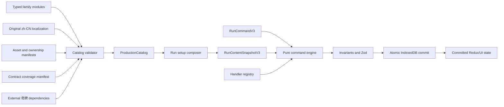

# Non-Joker Content Catalogs — Technical Design

## 1. Objective

Turn the V2 run/economy fixture engine into a production, versioned content
platform containing all 230 non-奇牌 collection rows while preserving deterministic
replay, atomic local persistence, original Chinese identity, and the existing
15-window effect ordering.

The task is content-heavy but not data-only. Its rows require new shared rule
primitives, a logical V3 run schema, migration, assets, manifests, and an audit
surface. Later children consume these contracts rather than reimplementing them.

## 2. Fundamental Constraints

- Gameplay rules remain framework-free under `src/game-core/**`.
- Durable state stores serializable data and IDs, never functions.
- Content IDs select definitions, not executable branches. Registered handlers
  emit an exhaustive operation union.
- Every random outcome is consumed from `RunState.rngState`, materialized before
  commit, and stable across rendering, browser, animation, and persistence timing.
- Existing V2 active runs must remain recoverable. They may not be silently
  replaced with production definitions or lose their embedded fixture snapshot.
- The product is original: research mappings are not runtime IDs, names, copy, or
  assets.
- The final progression and presentation children must be able to extend this
  work without changing the frozen mechanical meaning of existing rows.

## 3. Architecture



The catalog validator runs in tests and during application bootstrap. The runtime
aggregate is produced from the same family modules; there is no second manually
maintained count list.

## 4. Proposed File Boundaries

```text
src/
  content/
    catalogs/
      decks.ts stakes.ts challenges.ts
      vouchers.ts tarot.ts planets.ts spectral.ts tags.ts blinds.ts
      boosterProfiles.ts boosters.ts
      enhancements.ts seals.ts editions.ts stickers.ts
      index.ts
    dependencies/
      jokerIds.ts externalDependencies.ts testDoubles.ts  # doubles test-only
    localization/
      zh-CN.ts
    manifests/
      assets.ts ownership.ts contracts.ts
    schema/
      identity.ts availability.ts catalog.ts validateCatalog.ts
    assets/
      frames/ ...family subdirectories...
    productionCatalog.ts
  game-core/
    model/runV3.ts
    effects/operationsV3.ts registryV3.ts
    rules/runSetupV3.ts eligibilityV3.ts modifiersV3.ts
    rules/playingCardModifiersV3.ts
    commands/executeCommandV3.ts typesV3.ts
    invariants/validateRunStateV3.ts
  persistence/
    schemasV3.ts
    migrations/migrateRunV2ToV3.ts
  presentation/catalog/
    CatalogAuditScreen.tsx CatalogCard.tsx
tests/
  content/ game-core/ persistence/ presentation/ e2e/
```

Family files own rows, not arbitrary behavior. Shared mechanics live in rule or
effect modules once three or more rows use them.

## 5. Stable Identity and Catalog Schema

Shipped IDs use a stable project namespace independent of the current content
version:

```text
bxqp:deck:<slug>
bxqp:stake:<slug>
bxqp:challenge:<slug>
bxqp:voucher:<slug>
bxqp:consumable:tarot:<slug>
bxqp:consumable:planet:<slug>
bxqp:consumable:spectral:<slug>
bxqp:tag:<slug>
bxqp:blind:<slug>
bxqp:booster:<slug>
bxqp:enhancement:<slug>
bxqp:seal:<slug>
bxqp:edition:<slug>
bxqp:joker:001 ... bxqp:joker:150
```

The numeric 奇牌 IDs are reserved dependency targets; definitions remain owned by
the three later batches.

Every local row composes a common identity:

```ts
interface CatalogIdentity {
  readonly id: ContentId;
  readonly family: ContentFamily;
  readonly ordinal: number;
  readonly nameKey: LocalizationKey;
  readonly descriptionKey: LocalizationKey;
  readonly assetId: AssetId;
  readonly ownershipId: OwnershipRecordId;
  readonly introducedIn: 'catalog-baseline-3';
  readonly availability: AvailabilityRule;
  readonly unlockObjectiveId: string | null;
  readonly discoveryRule: DiscoveryRule;
}
```

Definitions reference localization keys and asset IDs. At run materialization,
the resolved Chinese name/description and relevant rule data are copied into the
snapshot so a saved run does not change when later copy is revised.

`AvailabilityRule` and `DiscoveryRule` are small discriminated unions, not free
form expressions. Examples include minimum Ante, prior content ownership,
prerequisite voucher, hand played this run, profile objective, challenge-only,
and explicit exclusion.

## 6. Family Definitions

### 6.1 Run setup content

- `DeckDefinitionV3` owns a starting card recipe, starting inventory/vouchers,
  baseline rule patches, pool patches, and run-window effects.
- `StakeDefinitionV3` owns a cumulative order, target curve, reward patches, and
  materialized sticker generation parameters.
- `ChallengeDefinitionV3` owns its starting card recipe, rule patches, starting
  inventory, bans, required external IDs, and profile-stat policy metadata.

These definitions compile into a `RunSetupV3`; command code never asks which deck
or challenge ID is active. Setup precedence is fixed:

1. engine baseline;
2. selected deck;
3. cumulative stakes from S01 through the selected row;
4. challenge overrides instead of ordinary deck/stake composition when a
   challenge is requested;
5. materialize starting inventory, card modifiers, lineup, and random outcomes.

### 6.2 Runtime catalog content

- Vouchers, tags, blinds, consumables, enhancements, seals, editions, and
  stickers reference generic handler and operation primitives.
- Booster collection rows reference one of fifteen immutable mechanical profiles.
  The 32 rows own separate identity/assets/weights; profiles own family, size,
  cost, options, picks, and temporary capacity.
- Pool eligibility is evaluated by one pure service with context for shop, pack,
  generated/free item, challenge, owned IDs, current offers, Ante, discovery,
  and external dependency availability.

### 6.3 Rule-patch operations

Run setup uses an exhaustive `RunRulePatch` union for configuration changes such
as hands, discards, hand size, slots, interest/rewards, shop weights, target
curves, price inflation, discard cost, acquisition bans, scoring caps, draw
visibility, starting deck recipes, and sticker rates. Runtime effects continue to
use the bounded effect queue.

Keeping setup patches separate from runtime `EffectOperation` prevents fake
`round-start` effects from reapplying permanent setup rules every round.

## 7. Effect Registry Expansion

Project-owned handler IDs use `bxqp:handler:<operation>` and are independent of
content families. V2 fixture handler IDs remain registered for migrated runs.

New operations are added only for irreducible shared semantics, including:

- set suit; copy full playing-card state; create randomized playing cards;
- apply/replace enhancement, seal, edition, and sticker;
- generate content by typed pool/rarity; create a named pack profile;
- adjust all hand levels or one hand's base Chips/Mult progression;
- adjust reward formulas, shop weights, offer slots, prices, and inflation;
- mark/debuff by rank, suit, prior-Ante play, or instance;
- enforce per-round hand-type restrictions and score caps;
- materialize random discard/destroy/disable/reorder/face-down outcomes;
- schedule one-shot shop/round/boss modifiers with explicit expiry.

Operations are applied by context-specific resolvers after the queue has passed
missing-handler, ancestry, and operation-budget checks. Neither handler functions
nor apply functions branch on content IDs.

## 8. Modifier and Sticker Semantics

Playing cards retain mutually exclusive `enhancementId`, `sealId`, and
`editionId`. Owned 奇牌 gain a serializable sticker list and edition-driven
instance slot contribution.

Execution order remains:

1. playing-card enhancement;
2. scored/held seal behavior;
3. playing-card edition;
4. 奇牌 edition before/after its own handler as defined by operation kind;
5. post-score destruction and round-end held effects.

Random checks are independent rolls in declared order. Debuff suppresses modifier
operations except the stone-like identity and negative-like capacity contribution.
Perishable counters decrement exactly once per completed round; rental upkeep is
an ordered round-end cost line and may enter allowed debt only when another rule
explicitly permits it.

## 9. Randomness and Materialization

Every random consumer has a deterministic sort key and consumes the current
state's PRNG in a declared sequence. Empty or fully excluded pools consume no RNG.
Materialized values include:

- D15 starting rank/suit assignments;
- stake sticker rolls and playing-card modifier rolls;
- tag pair and boss lineups;
- random card/奇牌/consumable creation;
- pack rows and option instances;
- random target cards, suits, ranks, editions, destruction, and disabled 奇牌;
- challenge face-down rolls;
- copied/reordered instance sequences.

The proposal stores results before returning. Presentation events contain IDs of
already committed results and cannot request another roll.

## 10. External 奇牌 Dependencies

`ExternalContentDependency` records the reserved ID, owning future task, required
capabilities, and local consumers. Validation has two modes:

- `catalog-child`: unresolved external 奇牌 IDs are allowed only when declared and
  covered by a test double matching the required capability contract;
- `integration-strict`: every external ID must resolve to a real definition and
  test doubles are forbidden.

Test doubles live under tests or a test-only module excluded from
`productionCatalog`. Count audits reject any `fixture:` ID or double in shipped
families.

This permits challenges and 奇牌-generating content to be mechanically complete
without stealing ownership from later batches.

## 11. V3 Run and Persistence Contract

### 11.1 Logical schema

New runs use:

```ts
const RUN_SCHEMA_VERSION_V3 = 3;
const CURRENT_CONTENT_VERSION = 'catalog-baseline-3';

type SupportedRunContentVersion =
  | 'run-economy-2'
  | 'catalog-baseline-3';
```

`RunStateV3` adds selected setup IDs, expanded rules/history, owned modifiers,
external dependency state, and `RunContentSnapshotV3`. A migrated V2 run is
wrapped as a legacy snapshot with empty production-only families and keeps
`run-economy-2`; a new run snapshots the production catalog and uses
`catalog-baseline-3`.

### 11.2 Migration

`migrateRunV2ToV3` is pure and must:

- preserve run/profile IDs, checkpoint, seed, RNG, phase, deck order, choices,
  inventory, offers, receipts, history, and embedded fixture definitions;
- add explicit defaults for new fields without consuming RNG;
- validate the result and produce byte-equivalent output on repeated migration;
- never map fixture IDs onto unrelated production rows.

Repository initialization upgrades logical meta to schema 3. In one IndexedDB
transaction it writes the pre-migration run to `recovery` and the migrated run to
`runs`; failure aborts both. Recovery decoding accepts V2 or V3 and migrates V2
only when the user loads it.

### 11.3 Export/import

Profile export version 3 separates envelope version from run content version.
Import accepts validated V2 and V3 envelopes, migrates V2 before confirmation,
checks the canonical checksum and 2 MB limit, and rejects unknown future schema or
content versions without touching current data.

Assets are referenced by stable IDs and are never embedded in saves or exports.

## 12. Localization, Assets, and Ownership

`zh-CN.ts` is the single player-facing string source for production content.
Definitions and tests use keys; the validator rejects missing, duplicate, empty,
or reference-identity strings identified by the ownership review list.

Each asset record contains:

```ts
interface AssetOwnershipRecord {
  readonly id: OwnershipRecordId;
  readonly contentId: ContentId;
  readonly assetPath: string;
  readonly source: 'project-svg' | 'project-raster' | 'generated-and-reviewed';
  readonly sourceFileOrPrompt: string;
  readonly author: '百戏奇牌项目';
  readonly reviewed: boolean;
  readonly notes: string;
}
```

Shared frames/textures are separate reusable assets. Every collection row still
has a unique focal asset or cover composition. Static imports make missing files a
build failure; the audit verifies no HTTP(S) content URL exists.

## 13. Catalog Audit Surface

A reusable `CatalogCard` renders resolved Chinese identity and local assets. A
query-gated local `CatalogAuditScreen` groups and paginates all families for
development, browser smoke tests, and visual review. It is not the final
collection/progression screen, but its components may be reused there.

The audit surface may scroll because it is a diagnostic catalog, while normal
gameplay screens retain the fixed 16:9 no-scroll contract. Browser tests sample
every family and programmatically assert all 230 images load with zero external
content requests.

## 14. Validation Strategy

### Static/generated audits

- exact family and total counts;
- stable ID/ordinal/localization/asset uniqueness;
- voucher prerequisites, booster profile links, and dependency ownership;
- every handler registered and every coverage ID resolvable;
- every asset exists and has a reviewed ownership record;
- no shipped fixture/test-double content.

### Contract tests

- Table-driven positive execution through public setup, command, or effect APIs.
- Boundary/rejection tests for target cardinality, capacity, empty pools, money,
  hand size, min Ante, prerequisites, exclusions, and indestructible content.
- Cross-family matrices for modifiers/retriggers/debuffs, tags/shops/packs,
  vouchers/weights/pricing, blinds/decks/stakes/challenges, and foreign 奇牌
  capabilities.
- Property tests mix accepted and rejected commands and run invariants after every
  checkpoint.

### Persistence and browser tests

- V2-to-V3 golden migration and idempotence;
- V3 Zod/structured-clone/export/import/IndexedDB/recovery round trips;
- injected migration/write/import failure and three-profile isolation;
- deterministic production scenarios in pure tests, Chromium, and WebKit;
- audit/image/local-network checks and representative gameplay snapshots.

## 15. Compatibility and Rollback

- Existing V1-to-V2 migration remains intact; loading chains V1 -> V2 -> V3.
- V2 fixture handlers and definitions remain available only for migrated runs and
  regression tests. New run creation never emits fixture IDs.
- A catalog change after this child requires a new content version, explicit save
  behavior, updated matrix, and regenerated golden fixtures.
- If migration or a family slice fails, rollback that slice before committing;
  never partially stamp logical schema 3.
- Asset polish can be replaced later without changing content IDs or mechanics,
  but ownership and dimension contracts must remain valid.

## 16. Important Deliberate Differences

- Numeric overflow stays positive Infinity with the existing wire codec instead
  of importing an unfinishable NaN state.
- Intended playing-card shop modifiers include seals even if a frozen reference
  build failed to generate them because of a known defect.
- Pack flows always retain a valid skip/exit path and reject impossible target
  states rather than reproducing a softlock.
- Hand/discard counts retain explicit minimum invariants; accidental reference
  interactions that increase a one-hand challenge are not copied.
